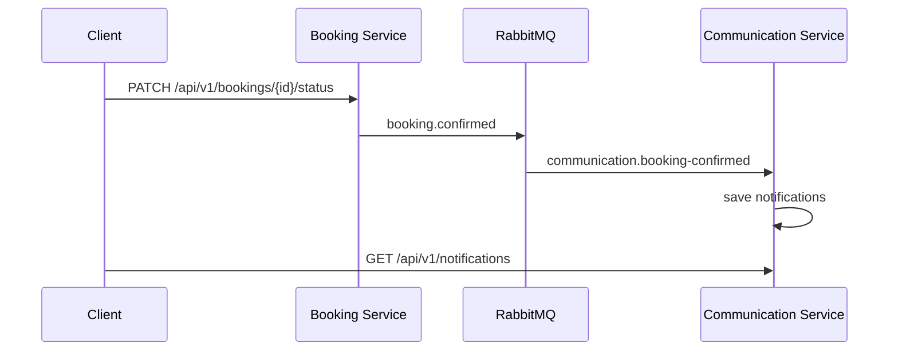

# ДЗ5: RabbitMQ в RentEase

## Цель

Реализовать асинхронное взаимодействие микросервисов через RabbitMQ.

Сценарий: после подтверждения бронирования `booking-service` публикует событие
`BookingConfirmed`. `communication-service` получает событие из очереди,
создает уведомление для арендатора и владельца объекта и отдает их через
`GET /api/v1/notifications`.



## Компоненты RabbitMQ

| Компонент | Значение |
|---|---|
| Exchange | `rentease.events` |
| Тип exchange | `direct` |
| Routing key | `booking.confirmed` |
| Queue | `communication.booking-confirmed` |
| Формат сообщения | JSON |

Событие содержит `event_id`, `booking_id`, `property_id`, `tenant_id`,
`landlord_id`, `status`, `occurred_at`. Очередь durable. Consumer проверяет
уникальность пары `booking_id + recipient_id`, поэтому повторная доставка не
создает дубликат уведомления.

## Запуск

Требуются JDK 21+, Maven и Docker Desktop.

1. Запустить RabbitMQ:

```powershell
cd "БР1.1/hw5"
docker compose up -d
```

Management UI доступен по адресу `http://localhost:15672`.

Логин: `rentease`, пароль: `rentease`.

2. Собрать Lab2:

```powershell
cd "БР1.1/Lab2"
mvn clean verify
```

3. Запустить сервисы Lab2 по инструкции из `БР1.1/Lab2/README.md`.

Сервисы `booking-service` и `communication-service` подключаются к RabbitMQ
по умолчанию через `localhost:5672`. Для другого адреса используются
`RABBITMQ_HOST`, `RABBITMQ_PORT`, `RABBITMQ_USER`, `RABBITMQ_PASSWORD`.

## Проверка

Запустить существующий smoke-тест Lab2:

```powershell
cd "БР1.1/Lab2"
.\smoke-test.ps1
```

После подтверждения бронирования выполнить запрос с токеном арендатора:

```powershell
curl.exe http://localhost:8080/api/v1/notifications `
  -H "Authorization: Bearer <TENANT_ACCESS_TOKEN>"
```

Ожидается HTTP 200 и уведомление типа `BOOKING_CONFIRMED`. В RabbitMQ UI
должны быть видны exchange `rentease.events` и очередь
`communication.booking-confirmed`; после обработки счетчик `Ready` очереди
возвращается к нулю.

## Ошибки и отказоустойчивость

Если RabbitMQ недоступен во время запуска consumer или publisher, сервис
пишет ошибку подключения в лог. Сообщение остается в durable-очереди до
обработки consumer. Повторная доставка безопасна благодаря проверке
уникальности уведомления.
