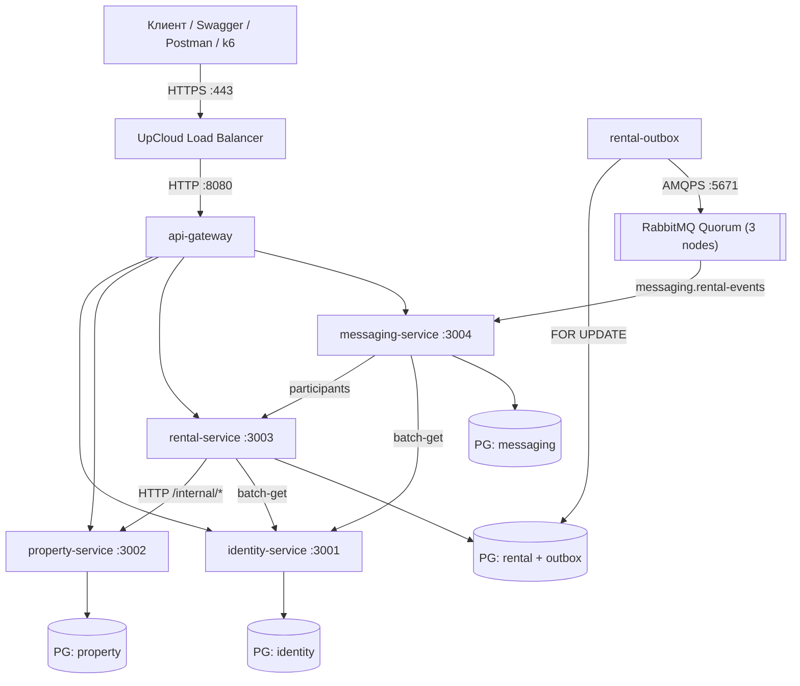

# Архитектура системы и модель данных

## Микросервисная схема взаимодействия

Приложение построено по принципу **database-per-service**: каждый доменный сервис работает со своей отдельной логической базой в Managed PostgreSQL 16 и отдельной учётной записью с правами только на свою БД.

## Ключевые архитектурные решения

1. **Изоляция данных (Database-per-Service):**

    - `identity`: таблица `users`.
    - `property`: таблицы `properties`, `locations`, `property_types`, `amenities`, `property_amenities`, `property_photos`.
    - `rental`: таблицы `rentals` (со снапшотами `property_title_snapshot`, `property_city_snapshot`, `price_per_month_snapshot`) и `rental_outbox`.
    - `messaging`: таблица `messages` с уникальным индексом по `event_id` для идемпотентности системных сообщений.
2. **Оптимистическое резервирование с компенсацией:**
   При создании сделки `rental-service` вызывает `PUT /api/v1/internal/properties/{id}/availability` с параметром `expected_available: true`. При гонке двух арендаторов второй запрос получает `409 Conflict`. При сбое локальной транзакции выполняется компенсирующий вызов, возвращающий `is_available = true`.
3. **Transactional Outbox и кворумные очереди RabbitMQ:**
   SQL-триггер записывает событие `rental.created` / `rental.completed` / `rental.cancelled` в таблицу `rental_outbox` в той же транзакции, что и изменение сделки. Отдельный Deployment `rental-outbox` выбирает следующую запись запросом `SELECT * FROM rental_outbox ORDER BY seq LIMIT 1 FOR UPDATE`, публикует её в RabbitMQ (AMQPS, 3 узла, кворумная очередь) и удаляет только после подтверждения брокера (`publisher confirms`). Вторая реплика `rental-outbox` ждёт на блокировке строки, обеспечивая строгий порядок событий и мгновенный подхват при падении активной реплики.
4. **Отказоустойчивый Managed PostgreSQL 16 (HA):**
   В UpCloud развёрнут двухузловой кластер Managed PostgreSQL 16 (`plan_node_count = 2`: primary + hot standby на физически раздельных хостах с автоматическим failover и регулярными бэкапами). Микросервисы подключаются по приватному DNS-имени `DB_HOST` на порту `11569` с обязательной проверкой TLS-сертификата CA UpCloud.
5. **Сетевая изоляция в Kubernetes:**
   В namespace `rental-lab7` действует политика `default-deny` на весь Ingress/Egress и набор точечных `NetworkPolicy` для каждой пары взаимодействующих сервисов.
