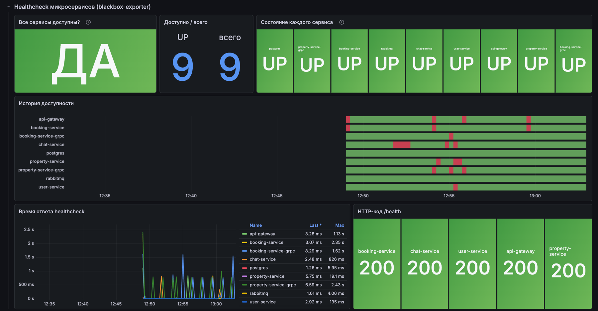

# ЛР4–5: развёртывание и мониторинг сервиса аренды недвижимости

Продолжение ЛР2–3 (папка `lab2-3`): те же Go-микросервисы, подготовленные к работе на
удалённом сервере (ЛР4), с мониторингом на Grafana (ЛР5), алертами на почту и Sentry
(доп. задания). Автодеплой из GitHub Actions — ДЗ6 (`homeworks/hw6`,
`.github/workflows/rental-cicd.yml` в корне репозитория).

```
            интернет
               │ :80 (:443)
        ┌──────▼──────┐ ВМ (Ubuntu), ufw: только 22/80/443
        │    nginx    │──── /grafana/ ───────────────┐
        └──────┬──────┘                              │
               │ 127.0.0.1:8080                      │ 127.0.0.1:3000
        ┌──────▼──────┐  HTTP   ┌──────────────┐   ┌─▼───────┐   ┌────────────┐
        │ api-gateway │────────▶│ user, chat   │   │ Grafana │◀──│ Prometheus │◀─ node-exporter (ВМ)
        │ (gin + grpc │  gRPC   │ property,    │   └─▲───────┘   └─────┬──────┘
        │   gateway)  │────────▶│ booking      │     │                 └──── blackbox-exporter ──▶ /health,
        └─────────────┘         └──┬────────┬──┘   ┌─┴────┐                  grpc.health, tcp всех сервисов
                                   │        │      │ Loki │◀── promtail ◀── docker.sock (логи всех контейнеров)
                              PostgreSQL  RabbitMQ └──────┘
              все сервисы ──▶ Sentry (self-hosted :8000 или sentry.io)
```

## Что изменилось относительно ЛР3

| | ЛР3 | ЛР4–5 |
|---|---|---|
| Порты | всё опубликовано на 0.0.0.0 (5432, 5672, 8081–8084, 9082–9083) | наружу только nginx; gateway и Grafana на `127.0.0.1` |
| Секреты | в `docker-compose.yaml` | в `.env` (в git только `.env.example`) |
| Надёжность | — | `restart: unless-stopped`, healthcheck каждого сервиса, `depends_on: service_healthy`, ротация логов |
| Образы | root, golang 1.23/1.25 | non-root пользователь, golang 1.25, `ca-certificates` |
| gRPC | — | `grpc.health.v1` в property/booking, recovery паник в интерсепторе |
| Багфиксы | gateway рвал gRPC-соединения через 15 с (`context.WithTimeout` в `Register*FromEndpoint`) | исправлено; пустые/невалидные `check_in_time` больше не роняют создание объявления |
| Ошибки | только `log.Printf` | Sentry: паники gin, ответы 5xx, ошибки gRPC Internal/Unknown/Unavailable |

## Структура

```
lab4-5/
├── docker-compose.yaml             # приложение (ЛР4)
├── docker-compose.monitoring.yaml  # мониторинг (ЛР5)
├── docker-compose.local.yaml       # override для Docker Desktop (macOS/Windows)
├── .env.example                    # все настройки и секреты
├── api-gateway/ user-service/ property-service/ booking-service/ chat-service/
│   └── internal/observability/     # Sentry (+ gRPC interceptor и health для property/booking)
├── deploy/
│   ├── scripts/bootstrap.sh        # подготовка сервера: docker, nginx, ufw, swap, пользователь deploy
│   ├── scripts/setup-nginx.sh      # установка конфига nginx (+ опционально HTTPS через certbot)
│   ├── scripts/deploy.sh           # сборка и запуск, ожидание healthcheck'ов
│   ├── nginx/rental.conf           # reverse proxy: / → gateway, /grafana/ → Grafana
│   ├── nginx/sentry.conf           # reverse proxy для self-hosted Sentry (:8000)
│   └── sentry/install-self-hosted.sh
├── monitoring/
│   ├── prometheus/prometheus.yml   # node, health-http, health-grpc, health-tcp
│   ├── blackbox/blackbox.yml       # модули http_health / grpc_health / tcp_connect
│   ├── loki/loki.yml  promtail/promtail.yml
│   └── grafana/
│       ├── provisioning/           # datasources, dashboards, alerting (правило, email, политика)
│       └── dashboards/rental-overview.json
└── docs/screenshots/
```

## Развёртывание на сервере (ЛР4)

```bash
# 1. на своей машине: скопировать проект на сервер
rsync -az --exclude .env ./ root@<IP>:/opt/rental/

# 2. на сервере (root): docker, nginx, ufw, swap, пользователь deploy с SSH-ключом
cd /opt/rental
SSH_PUBKEY="ssh-ed25519 AAAA... me@laptop" bash deploy/scripts/bootstrap.sh
chown -R deploy:deploy /opt/rental

# 3. секреты
cp .env.example .env && nano .env     # пароли, JWT_SECRET, GRAFANA_ROOT_URL=http://<IP>/grafana/

# 4. nginx и запуск
./deploy/scripts/setup-nginx.sh <IP или домен>
su deploy -c ./deploy/scripts/deploy.sh
```

Проверка: `http://<IP>/health`, `http://<IP>/swagger/index.html`, `http://<IP>/grafana/`.

`deploy.sh` умеет три режима (`DEPLOY_MODE` в `.env` или в окружении):

| режим | откуда образы | когда |
|---|---|---|
| `build` | собираются на сервере | обычная ВМ с запасом RAM |
| `local` | загружены заранее: `./deploy/scripts/push-images.sh root@<IP>` (кросс-сборка под `linux/amd64` на своей машине + `docker save \| ssh docker load`) | слабая/общая ВМ, ручной деплой |
| `pull` | GHCR, их собирает CI (ДЗ6) | автодеплой |

Текущий стенд — `http://13.143.182.131` (Debian 12, 1 vCPU, 1.9 ГБ RAM, рядом работает VPN),
поэтому у контейнеров приложения стоят `mem_limit` и `oom_score_adj`, а Go на сервере не собирается.

## Мониторинг (ЛР5)

Дашборд **Rental — мониторинг микросервисов** (домашняя страница Grafana) состоит из трёх блоков:

1. **Healthcheck** — «Все сервисы доступны? ДА/НЕТ», счётчик UP/всего, плитка на каждый сервис,
   история доступности (state timeline), время ответа, HTTP-код `/health`.
   Проверяются 9 целей: HTTP `/health` пяти сервисов, `grpc.health.v1` property/booking, TCP postgres/rabbitmq.
2. **Ресурсы ВМ** — CPU, RAM, диск (gauge), аптайм/ядра/объём, CPU по режимам, память, сеть in/out,
   дисковый I/O, заполненность ФС, load average.
3. **Логи контейнеров** — логи всех контейнеров на ВМ (Promtail читает Docker API), фильтр по
   контейнеру и regex-поиск, объём логов по контейнерам, число строк с error/panic/fatal.



### Доп. задание: алерт на почту (2 балла)

Правило `monitoring/grafana/provisioning/alerting/rules.yml`: `probe_success < 1` дольше 30 с →
письмо `🔴 DOWN: <service>`; при восстановлении — `🟢 UP: <service>`. Отдельный алерт на каждый
сервис. Локально письма ловит Mailpit (`http://127.0.0.1:8025`), на сервере — реальный SMTP
(`SMTP_*` в `.env`, например smtp.yandex.ru с паролем приложения).

Проверка: `docker stop rental_chat_service` → через ~1 мин письмо DOWN → `docker start ...` → письмо UP.

### Доп. задание: Sentry (4 балла self-hosted / 2 балла облако)

Во всех сервисах подключён `sentry-go` (`internal/observability`), управляется переменными `SENTRY_*`:

- gin: `sentrygin` ловит паники, отдельный middleware отправляет ответы 5xx (gateway — только свои 502–504);
- gRPC: unary-интерцептор отправляет ошибки `Internal/Unknown/DataLoss/Unavailable` с тегами
  `grpc.method`, `grpc.code` и перехватывает паники (раньше паника роняла весь сервис);
- `SENTRY_RELEASE` = git sha из CI, `SENTRY_ENVIRONMENT`, тег `service`;
- `SENTRY_DEBUG_ROUTE=true` включает `GET /debug/sentry` (тестовая паника; через nginx закрыт).

Self-hosted: `deploy/sentry/install-self-hosted.sh` ставит getsentry/self-hosted 26.10.0 в профиле
`errors-only` (нужно ≥ 2 CPU и 7 GB RAM) за nginx на порту 8000. Облачный вариант — создать проект
на sentry.io и вписать DSN в `.env`.

## Локальный запуск

```bash
cp .env.example .env
# на Docker Desktop: COMPOSE_FILE=docker-compose.yaml:docker-compose.monitoring.yaml:docker-compose.local.yaml
docker compose up -d --build
```

| | URL |
|---|---|
| API / Swagger | http://localhost:8080/swagger/index.html |
| Grafana | http://localhost:3000/grafana/ (admin / `GRAFANA_ADMIN_PASSWORD`) |
| Mailpit | http://localhost:8025 |
| RabbitMQ UI | http://localhost:15672 |
