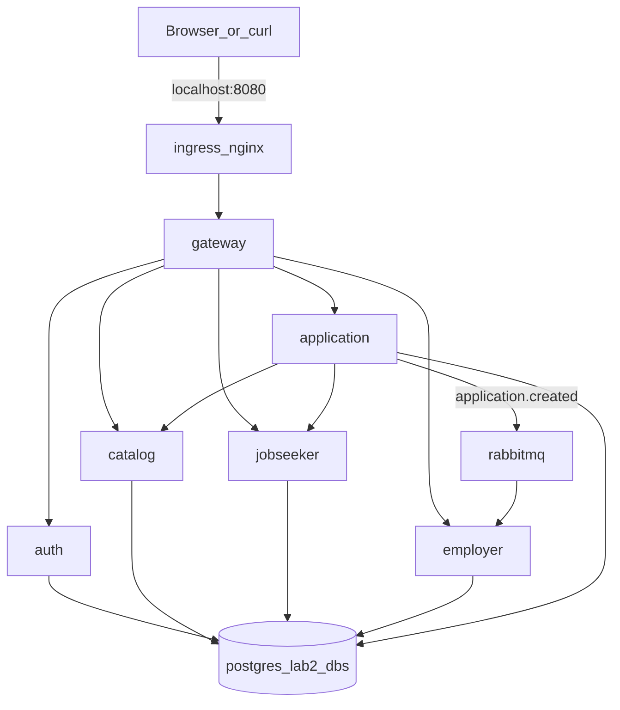

# Санкт-Петербургский национальный исследовательский университет ИТМО

Дисциплина: Бэк-энд разработка

Отчет

Домашнее задание 7

Тема: Технический дизайн облачной инфраструктуры для микросервисного веб-приложения

Выполнил: Филатов Арсений Сергеевич

Группа К3439

Проверил: Добряков Д. И.

Санкт-Петербург 2026 г.

## 1. Описание приложения

Приложение: сервис поиска работы (вариант 2 курса). Код в `labs/lab2`.

Снаружи только gateway. Внутри: auth, catalog, jobseeker, employer, application. У каждого своя БД PostgreSQL (`lab2_*`). Между сервисами HTTP с `x-internal-secret`. После отклика application шлет `application.created` в RabbitMQ, employer читает очередь.

| Сервис | Роль | БД / брокер |
|--------|------|-------------|
| gateway | маршрутизация, JWT | нет |
| auth | регистрация и вход | `lab2_auth` |
| catalog | отрасли, навыки, уровни | `lab2_catalog` |
| jobseeker | профили и резюме | `lab2_jobseeker` |
| employer | компании и вакансии | `lab2_employer` |
| application | отклики | `lab2_application`, RabbitMQ |

## 2. Модель размещения

Целевой контур: локальный Kubernetes на Docker через kind (Kubernetes IN Docker). Уровень CaaS: Deployment, Service, Ingress, readiness/liveness probes.

Стек: Docker Desktop, образы из Dockerfile ЛР3, манифесты в `labs/lab2/k8s/`.

Относительно ЛР4-ЛР6 (Compose на одной ВМ): rolling update, рестарт подов, единый деплой через `kubectl apply`.

## 3. Карта ресурсов

| Что в приложении | Ресурс |
|------------------|--------|
| Микросервисы | Deployment + ClusterIP Service в kind |
| Ноды | control-plane + worker (контейнеры Docker) |
| PostgreSQL | Deployment + PVC, пять БД `lab2_*` |
| RabbitMQ | Deployment в том же namespace |
| Образы | `docker build` + `kind load docker-image` (`lab2/<svc>:local`) |
| Вход | ingress-nginx, `http://localhost:8080` |
| Мониторинг | стек ЛР6 (Grafana/Prometheus/Loki) рядом с кластером |
| Секреты | K8s Secret (`JWT_SECRET`, `INTERNAL_SECRET`, пароли БД/MQ) |
| Сеть | Docker-сеть kind, DNS сервисов кластера |

Один Postgres на пять БД: изоляция database-per-service по именам БД. RabbitMQ в кластере рядом с сервисами.

## 4. Сетевая топология

- снаружи: Ingress на control-plane (порты 8080/8443);
- внутри: `http://auth:3001`, `http://catalog:3002` и т.д.;
- Postgres и RabbitMQ только ClusterIP.

Манифесты: `labs/lab2/k8s/`. Конфиг кластера: `labs/lab2/kind/config.yaml`.

## 5. Отказоустойчивость

| Сценарий | Поведение | Как закрываем |
|----------|-----------|---------------|
| Упал под сервиса | ReplicaSet создает новый | replicas >= 1, `/health` |
| Упала нода kind | поды на другой ноде / рестарт кластера | две ноды в kind-конфиге |
| Удалили данные в БД | восстановление из PVC / дампа | том Postgres, ручной dump при необходимости |
| Упал catalog | отклик не создать, остальной API жив | таймауты HTTP |
| Упал RabbitMQ | отклик в БД есть | retry у publisher |

- RTO: минуты при рестарте пода; при полном рестарте kind дольше.
- RPO: данные на PVC до сброса тома / последнего дампа.

## 6. План развертывания (ЛР7)

1. Создать kind-кластер `lab2` с пробросом 8080/8443.
2. Установить ingress-nginx, закрепить контроллер на control-plane.
3. Собрать образы и загрузить в kind.
4. Применить namespace, Secret, Postgres, RabbitMQ.
5. Задеплоить auth, catalog, jobseeker, employer, application, gateway.
6. Ingress на gateway, проверка `GET /health`.
7. Проверки: удалить под, `rollout undo`.

Скрипт: `labs/lab2/scripts/k8s-up.ps1`. В `homeworks/hw7` только этот отчет.

## 7. Вывод

Инфраструктура Job Search спроектирована как локальный Kubernetes (kind): сервисы, Postgres, RabbitMQ, Ingress. Реализация: ЛР7 по манифестам в `labs/lab2/k8s/`.
