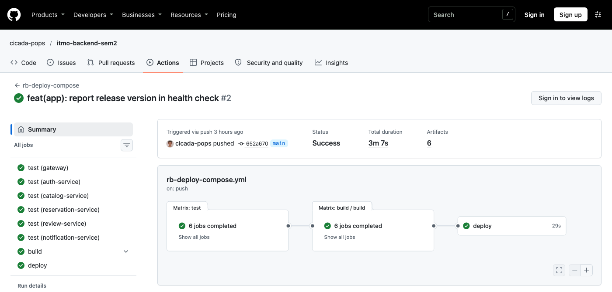
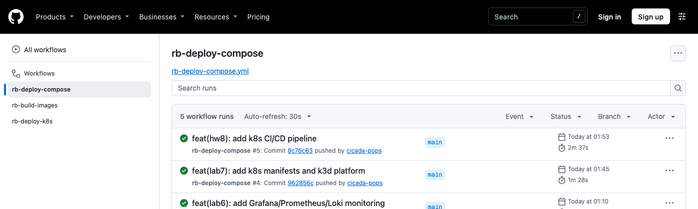

# ДЗ6. Настройка CI/CD (GitHub Actions) для автоматического развёртывания бэкенд-приложения

**Студент:** Якшин Артемий, БР1.1
**Проект:** «Restaurant Booking» (`labs/lab2`), стенд из ЛР4 (`labs/lab4`)

## Задача

Настроить автодеплой приложения на удалённый сервер с помощью GitHub Actions (или GitLab CI). Деплой должен запускаться при обновлении кода в определённой ветке репозитория.

## Ход работы

### 1. Где выполняется CI

Конвейер запускается в отдельном публичном репозитории `cicada-pops/itmo-backend-sem2`. Это зеркало рабочей ветки с той же структурой каталогов, что и в репозитории курса. Причины:

- на аккаунте нет оплаченных минут GitHub Actions, а для **публичных** репозиториев GitHub-hosted раннеры бесплатны;
- self-hosted раннер на публичном репозитории GitHub не рекомендует: PR из чужого форка мог бы выполнить код на сервере. Поэтому образы собираются на машинах GitHub, а сервер (он общий, ЛР4) не тратит ресурсы на сборку;
- workflow-файлы лежат в `.github/workflows/` в корне репозитория. В каждом job стоит условие `if: github.repository == 'cicada-pops/itmo-backend-sem2'`: в репозитории курса и в чужих форках эти файлы ничего не запускают.

**Триггер:** `push` в ветку **`main`**, если изменились код приложения (`**/labs/lab2/**`), конфигурация деплоя (`**/labs/lab4/deploy/**`) или сами workflow. Дополнительно есть ручной запуск `workflow_dispatch`.

### 2. Схема конвейера

```
push → main
  │
  ├─ test   (matrix × 6 сервисов)  npm ci → tsc (сборка/проверка типов)
  │
  ├─ build  (matrix × 6, reusable workflow rb-build-images.yml)
  │         docker buildx → ghcr.io/cicada-pops/rb-<service>:<sha> (+ :latest),
  │         кэш слоёв в GitHub Actions cache, build-arg APP_VERSION=<sha>
  │
  └─ deploy (environment: production)
            SSH → сервер: команда "app <sha>" + короткоживущий токен GHCR в stdin
            → deploy.sh: git checkout <sha>, docker compose pull/up --wait, проверка /health, откат при сбое
            → smoke-тест с раннера: /health (версия = <sha>), /api/v1/restaurants, /api/docs/
```



### 3. Сборка образов: `rb-build-images.yml`

Сборка вынесена в переиспользуемый workflow (`on: workflow_call`). Его вызывает и этот конвейер, и конвейер деплоя в Kubernetes из ДЗ8.

```yaml
jobs:
  build:
    if: github.repository == 'cicada-pops/itmo-backend-sem2'
    runs-on: ubuntu-24.04
    strategy:
      matrix:
        service: [gateway, auth-service, catalog-service, reservation-service, review-service, notification-service]
    steps:
      - uses: actions/checkout@v7
      - uses: docker/setup-buildx-action@v4
      - uses: docker/login-action@v4
        with: { registry: ghcr.io, username: "${{ github.actor }}", password: "${{ secrets.GITHUB_TOKEN }}" }
      - uses: docker/build-push-action@v7
        with:
          context: ${{ env.APP_DIR }}/${{ matrix.service }}
          platforms: linux/amd64
          push: true
          build-args: |
            APP_VERSION=${{ github.sha }}
          tags: |
            ghcr.io/cicada-pops/rb-${{ matrix.service }}:${{ github.sha }}
            ghcr.io/cicada-pops/rb-${{ matrix.service }}:latest
          cache-from: type=gha,scope=${{ matrix.service }}
          cache-to: type=gha,mode=max,scope=${{ matrix.service }}
```

Образы тегируются полным SHA коммита, поэтому релиз однозначно связан с кодом и его легко откатить. Через `APP_VERSION` SHA попадает внутрь образа, и каждый сервис отдаёт его в `/health`.

### 4. Деплой: доступ CI к серверу

Сервер общий, поэтому выдавать CI root-доступ по SSH нельзя. Доступ устроен по принципу минимальных привилегий (`server/setup-ci-access.sh`):

1. Создан пользователь **`rb-deploy`**: без пароля (`passwd -l`) и без возможности получить shell.
2. В `authorized_keys` ключ CI привязан к **forced command** с опцией `restrict`, которая запрещает pty и любые пробросы портов и агентов:
   ```
   restrict,command="/opt/rb-sem2/bin/deploy-gate.sh" ssh-ed25519 AAAA... gha-deploy@itmo-backend-sem2
   ```
3. `deploy-gate.sh` пропускает только строку вида `app <40 hex>` или `k8s <40 hex>` (регулярное выражение). Всё остальное отклоняется и пишется в syslog (`logger -t rb-deploy`).
4. sudoers (`/etc/sudoers.d/rb-deploy`, проверка через `visudo -cf`) разрешает `rb-deploy` ровно одну команду: `NOPASSWD: /opt/rb-sem2/bin/deploy.sh`. Скрипты принадлежат root, пользователь CI изменить их не может.

Проверка ограничений ключа CI (запуск с этим ключом вручную):

```
1) произвольная команда "id; cat /etc/shadow" → rejected: expected '<app|k8s> <40-hex sha>'   (exit=2)
2) инъекция "app 000…000; id"                  → rejected: expected '<app|k8s> <40-hex sha>'
3) интерактивный shell                          → rejected: expected '<app|k8s> <40-hex sha>'
4) "app 000…000" (формат верный, коммита нет)   → commit is not on origin/main -> abort
5) проброс порта ssh -L 13999:127.0.0.1:22      → channel 2: open failed: administratively prohibited

$ journalctl -t rb-deploy
rb-deploy[2007024]: rejected command: id; cat /etc/shadow
rb-deploy[2007154]: rejected command: app 0000000000000000000000000000000000000000; id
rb-deploy[2007206]: rejected command:
rb-deploy[2007293]: accepted: app 0000000000000000000000000000000000000000
rb-deploy[2011360]: accepted: app 980f53749234997cfa1c87a270169cc1c952a524
```

Секреты репозитория (Settings → Secrets → Actions): `DEPLOY_SSH_KEY` (приватный ключ ed25519, сгенерирован только для CI), `DEPLOY_HOST` (адрес сервера) и `DEPLOY_KNOWN_HOSTS` (отпечаток ключа сервера, `StrictHostKeyChecking=yes` защищает от подмены сервера). GitHub маскирует секреты в логах, поэтому в публичных логах адрес сервера выводится как `***`.

### 5. Скрипт деплоя `deploy.sh`

`server/deploy.sh` устанавливается в `/opt/rb-sem2/bin/` и выполняет:

1. **Блокировку** `flock`: два деплоя одновременно не пойдут.
2. **Вход в реестр** по токену из stdin. Это `GITHUB_TOKEN` текущего запуска с правом `packages: read`, он живёт только пока идёт job. Учётные данные пишутся во временный `DOCKER_CONFIG` и удаляются по `trap … EXIT`, поэтому в `/root/.docker` ничего не остаётся.
3. **Код ровно на нужном коммите**: `git fetch` и проверка `git merge-base --is-ancestor <sha> origin/main`. Развернуть можно только коммит из `main`.
4. **Релиз**: тег образов записывается в отдельный `release.env`. Он отделён от `.env` с секретами: секреты принадлежат серверу (ЛР4/ЛР5), тег релиза — конвейеру. Затем выполняется `docker compose pull` и `up -d --remove-orphans --wait`: команда ждёт, пока все контейнеры станут `healthy`.
5. **Синхронизацию конфигурации nginx** из репозитория (`nginx -t` и `nginx -s reload`, если конфиг изменился).
6. **Проверку** `http://127.0.0.1:8088/health` через nginx.
7. **Откат**: если хоть один шаг не прошёл, восстанавливается предыдущий `release.env`, выполняется `compose up`, скрипт завершается с ошибкой, и job в Actions краснеет.
8. **Очистку** старых образов: только своих `ghcr.io/cicada-pops/rb-*`, последние 3 тега остаются. Глобальный `docker prune` на общем сервере не используется.

Сам шаг деплоя в workflow:

```yaml
  deploy:
    needs: build
    runs-on: ubuntu-24.04
    environment: production
    permissions: { contents: read, packages: read }
    steps:
      - name: Configure SSH
        env: { SSH_KEY: "${{ secrets.DEPLOY_SSH_KEY }}", KNOWN_HOSTS: "${{ secrets.DEPLOY_KNOWN_HOSTS }}" }
        run: |
          install -m 700 -d ~/.ssh
          printf '%s\n' "$SSH_KEY" > ~/.ssh/deploy_key && chmod 600 ~/.ssh/deploy_key
          printf '%s\n' "$KNOWN_HOSTS" > ~/.ssh/known_hosts
      - name: Deploy release ${{ github.sha }}
        env: { HOST: "${{ secrets.DEPLOY_HOST }}", TOKEN: "${{ secrets.GITHUB_TOKEN }}" }
        run: |
          printf '%s\n' "$TOKEN" | ssh -i ~/.ssh/deploy_key -o BatchMode=yes -o StrictHostKeyChecking=yes \
            "rb-deploy@$HOST" "app ${{ github.sha }}"
      - name: Smoke test через nginx (публичный порт 8088)
        run: |
          curl -fsS --retry 5 --retry-delay 3 "http://$HOST:8088/health" | grep -q '"version":"${{ github.sha }}"'
          ...
```

### 6. Результаты запусков

Первый запуск (коммит `980f537`, добавление самого конвейера) прошёл целиком: 6 test-job'ов за 9–14 с, 6 build-job'ов за 58–76 с, deploy за 33 с. Второй запуск был проверкой цикла «изменили код → автоматически выкатили»: в `/health` сервисов добавлена версия релиза, коммит `652a670`.



Фрагмент лога job `deploy` второго запуска (публичный лог GitHub Actions):

```
[2026-11-10 16:31:22] [app 652a670] registry login ok (temporary DOCKER_CONFIG)
[2026-11-10 16:31:23] [app 652a670] sources at 652a670 feat(app): report release version in health check
[2026-11-10 16:31:23] [app 652a670] current release: 980f53749234997cfa1c87a270169cc1c952a524
 Image ghcr.io/cicada-pops/rb-gateway:652a670235b7a27f1fb1db791cd601c2481821b5 Pulled
 ... (6 образов)
[2026-11-10 16:31:45] [app 652a670] release 652a670235b7a27f1fb1db791cd601c2481821b5 is live
SERVICE                IMAGE                                                         STATUS
auth-service           ghcr.io/cicada-pops/rb-auth-service:652a670235b7a27f1f...    Up 17 seconds (healthy)
catalog-service        ghcr.io/cicada-pops/rb-catalog-service:652a670235b7a27...    Up 17 seconds (healthy)
gateway                ghcr.io/cicada-pops/rb-gateway:652a670235b7a27f1fb1db7...    Up 6 seconds (healthy)
notification-service   ghcr.io/cicada-pops/rb-notification-service:652a67023...    Up 17 seconds (healthy)
rabbitmq               rabbitmq:3.13-alpine                                          Up 12 minutes (healthy)
reservation-service    ghcr.io/cicada-pops/rb-reservation-service:652a670235...    Up 11 seconds (healthy)
review-service         ghcr.io/cicada-pops/rb-review-service:652a670235b7a27f...    Up 11 seconds (healthy)
GET /api/v1/restaurants -> 200
GET /api/docs/ -> 200
{"status":"ok","service":"api-gateway","version":"652a670235b7a27f1fb1db791cd601c2481821b5"}
```

RabbitMQ при этом не перезапускался (`Up 12 minutes`): compose пересоздаёт только контейнеры с изменившимся образом. Журнал релизов на сервере:

```
$ cat /opt/rb-sem2/releases.log
2026-11-10T16:27:16+00:00 app 980f53749234997cfa1c87a270169cc1c952a524
2026-11-10T16:31:45+00:00 app 652a670235b7a27f1fb1db791cd601c2481821b5
```

### 7. Проверка отката

Чтобы проверить откат, не ломая `main`, на сервер вручную был выкачен коммит `9d476bc`. Он есть в `main`, но образы для него не собирались, поэтому `docker compose pull` должен завершиться ошибкой:

```
[2026-11-10 16:35:49] [app 9d476bc] sources at 9d476bc fix(lab4): quote buildx cpuset and open root dir
[2026-11-10 16:35:49] [app 9d476bc] current release: 652a670235b7a27f1fb1db791cd601c2481821b5
[2026-11-10 16:35:50] [app 9d476bc] deploy FAILED -> rolling back to 652a670235b7a27f1fb1db791cd601c2481821b5
exit=1
$ cat /opt/rb-sem2/app/release.env
IMAGE_TAG=652a670235b7a27f1fb1db791cd601c2481821b5
$ curl -s http://127.0.0.1:8088/health
{"status":"ok","service":"api-gateway","version":"652a670235b7a27f1fb1db791cd601c2481821b5"}
```

Неудачный деплой не тронул работающий релиз, а скрипт вернул ненулевой код. В CI такой job завершился бы ошибкой.

### Файлы

| Файл | Назначение |
|---|---|
| `.github/workflows/rb-deploy-compose.yml` (корень репозитория) | конвейер test → build → deploy → smoke |
| `.github/workflows/rb-build-images.yml` | переиспользуемая сборка образов в GHCR |
| `server/deploy-gate.sh` | forced command: валидация команды CI |
| `server/deploy.sh` | деплой релиза с проверкой и откатом |
| `server/setup-ci-access.sh` | создание `rb-deploy`, sudoers, authorized_keys |

## Вывод

Настроен автодеплой бэкенд-приложения средствами GitHub Actions. Каждый push в ветку `main` с изменениями приложения или конфигурации запускает конвейер. Он проверяет и собирает все шесть сервисов, публикует образы с тегом коммита в GitHub Container Registry, выкатывает релиз на сервер и проверяет снаружи, что отвечает именно новая версия. Доступ CI к общему серверу ограничен: отдельный пользователь, ключ с forced command принимает только команду деплоя конкретного коммита из `main`, права root даны лишь на один скрипт, а учётные данные реестра живут только во время деплоя. Скрипт деплоя ждёт healthcheck'и контейнеров и при сбое возвращает предыдущий релиз, что подтверждено отдельной проверкой. Два реальных запуска конвейера завершились успешно, и обновление кода дошло до сервера без ручных действий.
