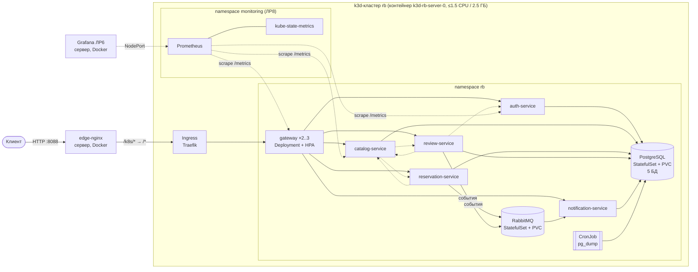
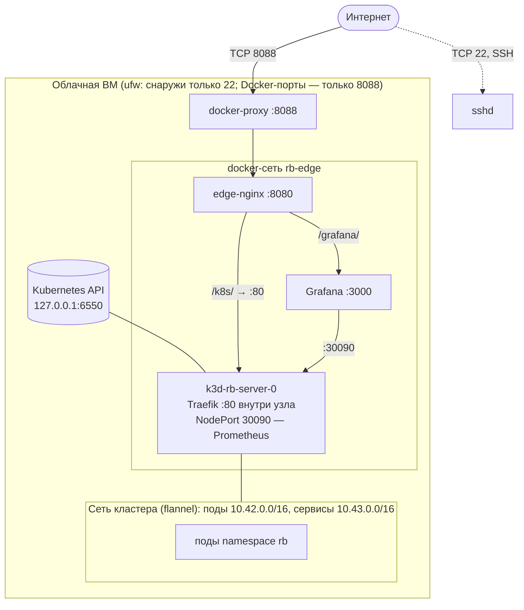
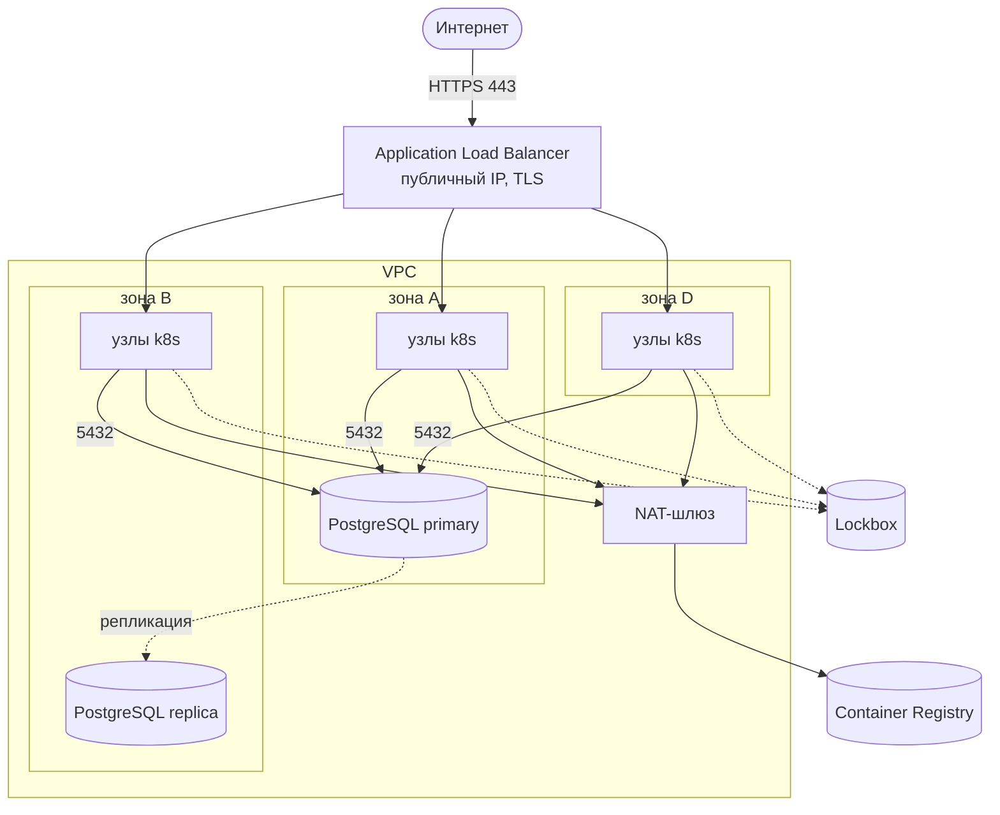

# ДЗ7. Технический дизайн облачной инфраструктуры для микросервисного веб-приложения

**Студент:** Якшин Артемий, БР1.1
**Проект:** «Restaurant Booking» — микросервисы из ЛР2–ЛР5

## Задача

Разработать технический дизайн облачной инфраструктуры для микросервисного веб-приложения: архитектурные решения, облачные ресурсы, сетевую связность и отказоустойчивость. По этому дизайну в ЛР7 выполняется облачное развёртывание, в ДЗ8 строится CI/CD, в ЛР8 настраиваются нагрузочное тестирование и автоскейлинг.

## Ход работы

### 1. Исходные данные

**Приложение.** Шесть сервисов на Node.js 22 + TypeScript (Express, TypeORM), каждый в своём Docker-образе (ЛР4):

| Сервис | Порт | Хранит | Зависит от |
|---|---|---|---|
| `gateway` (API Gateway) | 3000 | — | все сервисы (маршрутизация `/api/v1/*`) |
| `auth-service` | 8081 | пользователи | — |
| `catalog-service` | 8082 | рестораны, меню, столики | review, reservation (обогащение) |
| `reservation-service` | 8083 | бронирования | catalog; публикует события |
| `review-service` | 8084 | отзывы | catalog, auth; публикует события |
| `notification-service` | 8085 | уведомления | потребляет события RabbitMQ |
| RabbitMQ | 5672 | очередь `notifications` | — |

Взаимодействие: синхронное — REST с заголовком `X-Internal-Key`, асинхронное — topic-exchange `restaurant.events` (ДЗ5). Каждый сервис отдаёт `/health` и `/metrics` (ЛР4/ЛР6).

**Нефункциональные требования** (уточняются нагрузочным тестированием в ДЗ10/ЛР8):

| Требование | Целевое значение |
|---|---|
| Доступность API | 99.5 % в месяц (≈ 3.6 ч простоя) |
| Задержка чтения (каталог) | p95 < 300 мс при 50 RPS |
| Ошибки | < 1 % ответов 5xx |
| Обновление версий | без простоя (rolling update) |
| Потеря данных (RPO) | ≤ 24 ч (учебный стенд) / ≤ 5 мин (production) |
| Восстановление (RTO) | ≤ 30 мин / ≤ 5 мин |
| Масштабирование | горизонтальное, автоматическое по нагрузке |
| Безопасность | наружу только HTTP-вход; секреты вне git; сегментация сети |

**Ограничения.** Бюджет учебного проекта — одна облачная ВМ (VPS: 4 vCPU, 8 ГБ RAM, Ubuntu 24.04). На ней уже работает другой проект, который занимает порты 80/443 и часть ресурсов. Отсюда два уровня дизайна:

- **Вариант A (реализуется в ЛР7):** Kubernetes-кластер k3s на облачной ВМ, жёстко ограниченный по ресурсам;
- **Вариант B (целевой production):** тот же набор манифестов в управляемом Kubernetes провайдера (на примере Yandex Cloud) с управляемыми БД, балансировщиком и реестром.

Манифесты приложения в обоих вариантах одинаковые, различаются только платформенные ресурсы. Поэтому переход A → B — это смена окружения, а не переписывание приложения.

### 2. Архитектурные решения

| # | Решение | Альтернативы | Обоснование |
|---|---|---|---|
| АР-1 | Оркестрация — **Kubernetes** | docker compose (ЛР4), Docker Swarm | самовосстановление подов, rolling update, HPA, декларативные манифесты, переносимость между облаками. У compose нет ни автоскейлинга, ни перезапуска по liveness-пробе |
| АР-2 | Дистрибутив для варианта A — **k3s в Docker (k3d)** | kubeadm, k3s прямо на хосте | k3s — сертифицированный лёгкий Kubernetes (~500 МБ RAM на control plane). Через k3d весь кластер живёт в контейнере: ограничивается cgroup'ами, не трогает iptables и порты хоста, удаляется одной командой. Это критично на общем сервере |
| АР-3 | Сервисы **stateless**, состояние — в PostgreSQL и RabbitMQ | SQLite-файл в каждом поде (как в compose) | SQLite на RWO-томе не масштабируется: две реплики не могут писать в один файл. С вынесенной БД поды взаимозаменяемы, и HPA может добавлять реплики (ЛР8) |
| АР-4 | **database-per-service** внутри одного экземпляра PostgreSQL | отдельный экземпляр на сервис | сохраняется изоляция данных из ДЗ4 (у сервиса своя БД, чужие таблицы ему недоступны) при пятикратно меньшем расходе памяти. В варианте B экземпляр — управляемый HA-кластер |
| АР-5 | Схема БД и сиды — под **`pg_advisory_lock`** | init-Job, миграции перед деплоем | при одновременном старте N реплик схему создаёт ровно одна, остальные ждут блокировку. Проверено на 3 репликах (ЛР4) |
| АР-6 | Вход — **edge-nginx → Ingress (Traefik) → gateway** | NodePort, LoadBalancer на gateway | Ingress — стандартная точка маршрутизации L7 в кластере. Edge-nginx уже обслуживает порт 8088 сервера (ЛР4) и добавляет префикс `/k8s/`. В варианте B вместо edge-nginx стоит облачный L7-балансировщик с TLS |
| АР-7 | Образы — **GHCR**, тег = SHA коммита | `latest`, semver | неизменяемые теги: релиз однозначно связан с коммитом, откат — это повторный деплой старого SHA (ДЗ6/ДЗ8) |
| АР-8 | Секреты — **Kubernetes Secret, создаваемый на сервере** из файла вне git | Secret в репозитории, Sealed Secrets | в публичном репозитории нет ни одного секрета. В варианте B — облачное хранилище секретов + External Secrets Operator |
| АР-9 | Наблюдаемость — **Prometheus + Grafana + Loki** (ЛР6) + Prometheus внутри кластера (ЛР8) | облачный мониторинг | единый инструмент для ВМ, compose-стенда и кластера; дашборды как код |
| АР-10 | Масштабирование — **HPA по CPU** (ЛР8) + Cluster Autoscaler (B) | ручное | нагрузка неравномерна (вечерний пик бронирований) |

### 3. Логическая схема



### 4. Облачные ресурсы

#### Вариант A — Kubernetes на облачной ВМ (реализация ЛР7)

| Ресурс | Параметры | Назначение |
|---|---|---|
| ВМ (VPS) | 4 vCPU, 8 ГБ, 60 ГБ SSD, Ubuntu 24.04, публичный IPv4 | хост для всех компонентов |
| Docker-сеть `rb-edge` | bridge | связывает edge-nginx, Grafana и узел k3d |
| Кластер k3d `rb` | k3s v1.36.6, 1 узел (server+worker), образ `rancher/k3s:v1.36.6-k3s1` | Kubernetes |
| Ограничения узла | `--servers-memory 2560m`, `docker update --cpuset-cpus 2,3 --cpus 1.5` | кластер не может занять больше 1.5 ядра и 2.5 ГБ, ядра 0–1 остаются соседнему проекту |
| Kubernetes API | `127.0.0.1:6550` | доступен только с самого сервера, наружу не публикуется |
| Хранилище | StorageClass `local-path`, каталог узла смонтирован в `/opt/rb-sem2/k3d/storage` | PVC PostgreSQL (2 Ги), RabbitMQ (1 Ги), бэкапов (1 Ги). Данные переживают пересоздание контейнера узла |
| Ingress | Traefik (встроен в k3s), ServiceLB занимает порты 80/443 **внутри контейнера узла** | порты 80/443 хоста не затрагиваются |
| Метрики для HPA | metrics-server (встроен в k3s) | CPU/RAM подов |
| Реестр | GitHub Container Registry | образы импортируются в containerd узла при деплое |

#### Вариант B — управляемое облако (целевой production, на примере Yandex Cloud)

| Ресурс | Параметры | Чем заменяет вариант A |
|---|---|---|
| VPC + 3 подсети в зонах `ru-central1-a/b/d` | приватные подсети для узлов, отдельная подсеть для БД | docker-сети |
| Managed Service for Kubernetes | регион, master в 3 зонах; группа узлов 3–6 × (2 vCPU, 4 ГБ), автомасштабирование | k3d-кластер |
| Managed Service for PostgreSQL | 2 хоста в разных зонах (primary + реплика), автоматическое переключение, бэкапы + PITR 7 дней | StatefulSet PostgreSQL |
| RabbitMQ Cluster Operator | 3 пода в разных зонах, quorum-очереди, PVC на сетевых дисках | StatefulSet RabbitMQ на 1 поде |
| Application Load Balancer + Ingress-контроллер ALB | публичный IP, HTTPS, сертификат из Certificate Manager | edge-nginx + Traefik |
| Container Registry | сканирование уязвимостей образов | GHCR |
| Lockbox + External Secrets Operator | секреты с версионированием и аудитом доступа | Secret из файла на сервере |
| Object Storage | бакет бэкапов с политикой хранения | PVC с дампами |
| NAT-шлюз | исходящий трафик узлов без публичных IP | публичный IP ВМ |
| Мониторинг | Prometheus + Grafana + Loki в кластере (или облачные Monitoring/Logging) | стек ЛР6 на ВМ |

### 5. Сетевая связность

#### Вариант A



| Поток | Откуда → куда | Порт | Разрешение |
|---|---|---|---|
| Клиенты | интернет → edge-nginx | 8088/tcp | единственный опубликованный Docker-порт |
| Администрирование | интернет → sshd | 22/tcp | ufw; ключи |
| Kubernetes API | хост → узел k3d | 6550/tcp | только `127.0.0.1` |
| Вход в кластер | edge-nginx → Traefik | 80/tcp внутри сети `rb-edge` | — |
| Ingress → gateway | `kube-system` → `rb` | 3000/tcp | NetworkPolicy `allow-ingress-controller-to-gateway` |
| Между сервисами | `rb` → `rb` | 8081–8085, 5432, 5672 | NetworkPolicy `allow-same-namespace` |
| Сбор метрик | `monitoring` → `rb` | порты `/metrics` | NetworkPolicy `allow-monitoring-scrape` |
| Всё остальное входящее в `rb` | — | — | **запрещено** (`default-deny-ingress`) |

NetworkPolicy применяет встроенный в k3s kube-router. Поды из других пространств имён не достают ни до БД, ни до сервисов. Это проверено пробными подами (раздел 9).

#### Вариант B



Группы безопасности:

| Группа | Входящие | Источник |
|---|---|---|
| `sg-alb` | 443/tcp, 80/tcp (редирект на 443) | 0.0.0.0/0 |
| `sg-nodes` | NodePort-диапазон / порты Ingress | только `sg-alb` |
| | весь трафик | `sg-nodes` (меж-подовая сеть, kube-proxy) |
| | 10250/tcp (kubelet) | подсеть master'а |
| `sg-db` | 6432/tcp (PgBouncer) | только `sg-nodes` |
| SSH к узлам | закрыт | доступ только через `kubectl debug` / bastion |

### 6. Ресурсы и ёмкость (вариант A)

Запросы и лимиты контейнеров — стартовые. В ЛР8 они уточняются по результатам нагрузочного теста.

| Компонент | Реплики | requests CPU / RAM | limits CPU / RAM |
|---|---|---|---|
| gateway | 2 (HPA 2–4) | 50m / 96Mi | 500m / 192Mi |
| auth, catalog, reservation, review, notification | по 1 (HPA для нагруженных 1–3) | 50m / 96Mi | 500m / 192Mi |
| PostgreSQL | 1 | 100m / 128Mi | 1 / 384Mi |
| RabbitMQ | 1 | 100m / 192Mi | 500m / 384Mi |
| системные (k3s, Traefik, CoreDNS, metrics-server) | — | ~300m / ~600Mi (факт) | — |

> Диапазоны HPA и requests/limits в таблице — стартовые значения дизайна. В ЛР8 по результатам нагрузочных испытаний они уточнены: gateway 2–3, auth-service 1–3, catalog-service 1–2, review-service 1–2 реплики, reservation-service без HPA; requests 25–150m, CPU-лимиты auth и catalog — 1 ядро (подробно — в отчёте ЛР8).

Расчёт памяти: 7 подов приложения × ~70 МиБ + PostgreSQL ~60 МиБ + RabbitMQ ~130 МиБ + k3s ~600 МиБ ≈ 1.3 ГиБ. Это укладывается в лимит узла 2.5 ГиБ с запасом под масштабирование: каждая дополнительная реплика добавляет ~70 МиБ. Узел k3s при этом считает, что у него 4 ядра: cgroup-ограничение `--cpus 1.5` ядру Kubernetes не видно. Поэтому реальный потолок CPU — 1.5 ядра, и HPA в ЛР8 упрётся именно в него.

Вариант B на ту же нагрузку: 3 узла по 2 vCPU / 4 ГБ, по одному в каждой зоне. При пиковой нагрузке Cluster Autoscaler добавляет узлы до 6.

### 7. Отказоустойчивость

| Сценарий отказа | Вариант A (ЛР7) | Вариант B (production) |
|---|---|---|
| Процесс сервиса упал или завис | liveness-проба `/health` → kubelet перезапускает контейнер; readiness-проба выводит под из балансировки | то же |
| Медленный старт (ждём БД или брокер) | startup-проба даёт до 120 с, liveness до этого не срабатывает | то же |
| Падение одной реплики gateway | вторая реплика продолжает обслуживать, PDB `minAvailable: 1` | реплики в разных зонах (`topologySpreadConstraints`) |
| Недоступен зависимый сервис | мягкая деградация (ЛР2): обогащение пропускается, критичные операции отвечают 503; события копятся в durable-очереди | то же |
| Неудачный релиз | rolling update `maxUnavailable: 0`: новые поды должны пройти readiness, иначе старые не удаляются; CD делает `kubectl rollout undo` (ДЗ8) | то же + canary через веса ALB |
| Падение PostgreSQL | под пересоздаётся StatefulSet'ом, данные на PVC; ежедневный `pg_dump` (CronJob, 7 копий) | автоматическое переключение на реплику в другой зоне, PITR |
| Падение RabbitMQ | под пересоздаётся, durable-очередь и persistent-сообщения на PVC | кворумные очереди на 3 узлах |
| Падение узла или ВМ | **единая точка отказа**: после перезапуска ВМ кластер и данные поднимаются (restart policy контейнера, PVC на диске хоста) | узлы в 3 зонах, поды переезжают, Cluster Autoscaler восстанавливает ёмкость |
| Перегрузка | HPA добавляет реплики в пределах 1.5 CPU узла (ЛР8) | HPA + Cluster Autoscaler |
| Потеря зоны | — | 2 из 3 зон обслуживают трафик, БД переключается |

Вариант A честно не выполняет требование 99.5 %: одна ВМ — единая точка отказа, и это осознанный компромисс учебного бюджета. Вариант B закрывает его за счёт трёх зон и управляемой БД с репликой.

### 8. Безопасность

- **Секреты** (`JWT_SECRET`, `INTERNAL_API_KEY`, пароли PostgreSQL и RabbitMQ) генерируются на сервере (`openssl rand`), хранятся в `/opt/rb-sem2/k8s/secrets.env` (`0600`) и загружаются в Secret `rb-secrets`. В пароли подов они попадают через `secretKeyRef`, в манифестах их нет.
- **Pod Security Admission** на пространстве `rb`: `enforce: baseline` (привилегированные поды запрещены) и `audit: restricted`.
- **Контейнеры сервисов:** `runAsNonRoot` (uid 1000), `readOnlyRootFilesystem`, `allowPrivilegeEscalation: false`, `capabilities.drop: [ALL]`, `seccompProfile: RuntimeDefault`. Запись разрешена только в `emptyDir /tmp`.
- **Сеть:** default-deny + явные разрешения (раздел 5); Kubernetes API только на loopback.
- **Цепочка поставки:** образы собираются в CI из коммита `main`, тег неизменяем, на сервер попадает только коммит из `main` (ДЗ6).

### 9. Проверка дизайна на локальном кластере

До развёртывания в облаке манифесты прогнаны на локальном k3d с теми же версиями: k3d v5.9.0, k3s v1.36.6, образы собраны локально. Результаты:

- все 9 подов (`gateway`×2, пять сервисов, PostgreSQL, RabbitMQ) перешли в `Running`. Холодный старт с пустыми томами занял ~20 с;
- первая версия манифестов давала по одному рестарту `reservation-service` и `review-service`. Пока под PostgreSQL не готов, его headless-имя не резолвится, а сервис ещё ждёт брокер, и 60 секунд startup-пробы не хватило. Окно расширено до 120 с, после этого рестартов нет;
- сквозной сценарий через Ingress (вход → каталог → бронь → событие → уведомление) прошёл;
- проверка NetworkPolicy пробными подами:

```
из чужого пространства -> catalog-service:   BLOCKED
из чужого пространства -> gateway:           BLOCKED
из пространства rb      -> catalog-service:   ALLOWED
```

### 10. План перехода compose → Kubernetes (выполняется в ЛР7)

1. Приложение: поддержка PostgreSQL через `DATABASE_URL`, advisory-lock на миграции, `/metrics`, graceful shutdown (сделано в ЛР4).
2. Манифесты: kustomize-база `labs/lab7/k8s/base` + overlay `prod` с реестром и тегом.
3. Платформа: Ansible-роль `k3d` (бинарники k3d/kubectl с проверкой sha256, кластер с лимитами, kubeconfig вне `~/.kube`, Secret из файла).
4. Edge: маршрут `/k8s/` в edge-nginx.
5. Деплой: `deploy.sh k8s <sha>` — импорт образов в containerd узла, `kubectl apply -k`, ожидание rollout, откат при сбое (автоматизируется в ДЗ8).
6. Мониторинг кластера и HPA — в ЛР8.

## Вывод

Разработан технический дизайн облачной инфраструктуры для микросервисного приложения «Restaurant Booking» на двух уровнях. Вариант A — Kubernetes (k3s в k3d) на облачной ВМ с жёсткими ограничениями ресурсов. Он реализуем в рамках учебного бюджета и безопасен для соседнего проекта на общем сервере. Вариант B — целевая production-схема в управляемом облаке: управляемый Kubernetes в трёх зонах, управляемый PostgreSQL с репликой, L7-балансировщик с TLS, реестр и хранилище секретов. Для обоих вариантов описаны архитектурные решения с альтернативами и обоснованием, перечень облачных ресурсов, сетевые потоки с правилами доступа, расчёт ресурсов и сценарии отказов. Ключевое решение — сделать сервисы stateless и вынести состояние в PostgreSQL и RabbitMQ. Именно это позволяет горизонтально масштабировать поды и переносить одни и те же манифесты между окружениями. Дизайн проверен на локальном кластере: манифесты разворачиваются, сценарий проходит через Ingress, сетевые политики действуют. Найденная при проверке проблема со startup-пробой исправлена до развёртывания в облаке.
