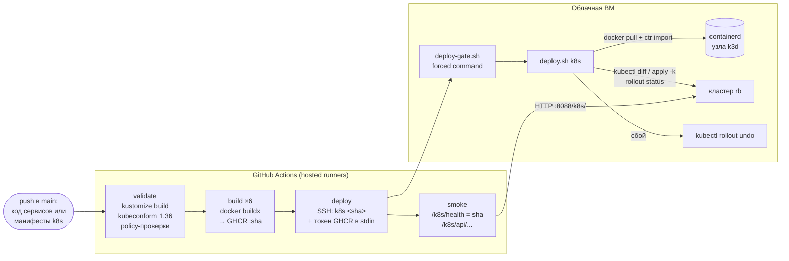
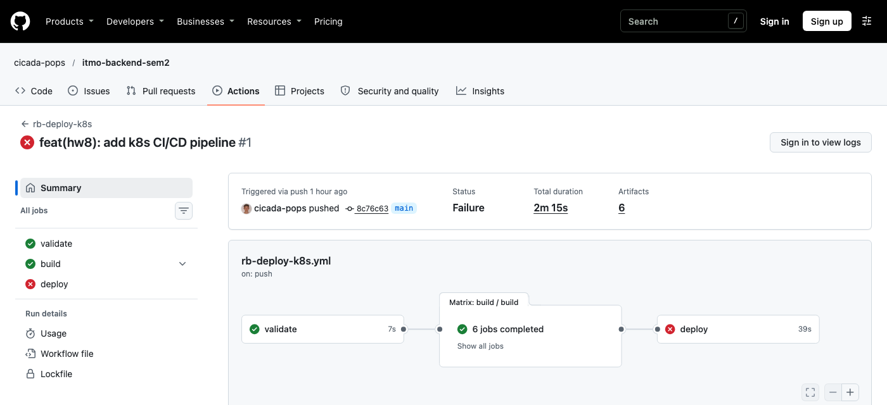
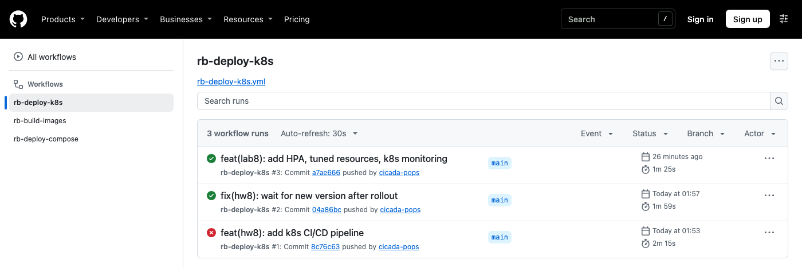
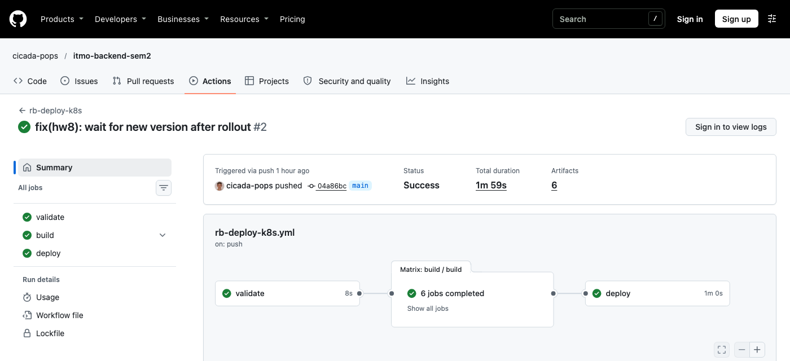

# ДЗ8. Настройка CI/CD для облачной инфраструктуры

**Студент:** Якшин Артемий, БР1.1
**Проект:** «Restaurant Booking»; целевая инфраструктура — k3d-кластер из ЛР7 (дизайн ДЗ7)

## Задача

Реализовать автоматизированный конвейер непрерывной интеграции и непрерывной доставки (CI/CD) компонентов микросервисного приложения в целевую облачную инфраструктуру.

## Ход работы

### 1. Общая схема

Конвейер `.github/workflows/rb-deploy-k8s.yml` работает в том же публичном CI-репозитории, что и в ДЗ6, на GitHub-hosted раннерах. Из ДЗ6 переиспользованы сборка образов (reusable workflow `rb-build-images.yml`) и защищённый канал на сервер: пользователь `rb-deploy` и ключ с forced command, который теперь принимает и команду `k8s <sha>`.



**Триггеры:** `push` в `main`, если изменились код сервисов (`**/labs/lab2/**`), манифесты (`**/labs/lab7/k8s/**`, `**/labs/lab8/k8s/**`) или сами workflow, а также ручной запуск. Правка только манифестов (например, лимитов) тоже проходит весь путь: образы для нового SHA собираются из кэша слоёв за 20–40 с.

### 2. CI: проверки до сборки

Job `validate` ловит ошибки в манифестах до того, как что-то попадёт в кластер:

1. **рендер kustomize:** `kubectl kustomize labs/lab7/k8s/overlays/prod`. Отсутствующий файл, неверный патч или несуществующий ресурс в `kustomization.yaml` останавливают конвейер;
2. **проверка схем:** `kubeconform -strict` против JSON-схем Kubernetes **1.36** (версия кластера). Режим `-strict` отклоняет и неизвестные поля, то есть опечатки в именах полей;
3. **policy-проверки** (Python + PyYAML):
   - у каждого контейнера Deployment и StatefulSet есть `requests` и `limits`;
   - у каждого контейнера есть readiness- и liveness-пробы;
   - у сервисов приложения корневая ФС только для чтения.

```
Summary: 27 resources found in 1 file - Valid: 27, Invalid: 0, Errors: 0, Skipped: 0
policy: OK
```

Kubectl и kubeconform скачиваются с проверкой sha256. Затем job `build` собирает и публикует 6 образов с тегом `<sha>`, так же как в ДЗ6. Для сборки задан `concurrency` по SHA: если коммит меняет код сервисов, его одновременно собирают конвейеры ДЗ6 (compose) и ДЗ8 (k8s), и вторая сборка ждёт первую, а потом берётся из кэша слоёв.

### 3. CD: доставка в кластер

Job `deploy` (environment `production-k8s`) передаёт серверу только строку `k8s <sha>` и короткоживущий `GITHUB_TOKEN` (`packages: read`). Kubernetes API кластера наружу не публикуется (ЛР7), поэтому kubeconfig в CI нет, и права на кластер у конвейера отсутствуют. Всё, что он может, — попросить сервер выкатить конкретный коммит из `main`.

На сервере `deploy.sh k8s <sha>` (`homeworks/hw6/server/deploy.sh`):

```bash
deploy_k8s() {
  export KUBECONFIG=$ROOT/k3d/kubeconfig
  # 1. образы релиза -> containerd узла k3d (кластеру не нужен доступ к реестру и pull-секреты)
  for s in "${SERVICES[@]}"; do
    img="$IMAGE_PREFIX-$s:$sha"
    docker image inspect "$img" >/dev/null 2>&1 || docker pull -q "$img" >/dev/null
    imgs+=("$img")
  done
  docker save "${imgs[@]}" | docker exec -i "$K8S_NODE" ctr -n k8s.io images import - >/dev/null
  # 2. манифесты ровно этого коммита + слой release с тегом образов (во временной копии)
  {
    echo "resources: [../prod]"
    echo "images:"
    for s in "${SERVICES[@]}"; do echo "  - { name: $IMAGE_PREFIX-$s, newTag: \"$sha\" }"; done
  } > "$rel/kustomization.yaml"
  kubectl -n rb diff -k "$rel" | ...            # в лог CD: что изменится
  kubectl -n rb apply -k "$rel"
  # 3. ожидание rollout каждого Deployment и проверка, что через Ingress отвечает новая версия
  for s in "${SERVICES[@]}"; do kubectl -n rb rollout status "deploy/$s" --timeout=180s || fail=1; done
  if ((fail == 0)) && wait_version "http://127.0.0.1:8088/k8s/health" "$sha"; then
    echo "$(date -Is) k8s $sha" >> "$ROOT/releases.log"; return 0
  fi
  # 4. откат
  for s in "${SERVICES[@]}"; do kubectl -n rb rollout undo "deploy/$s"; done
  return 1
}
```

Финальный шаг `smoke` уже с раннера GitHub, через интернет, проверяет: `/k8s/health` отдаёт версию, равную SHA коммита, а `/k8s/api/v1/restaurants`, `/k8s/api/v1/cuisines` и `/k8s/api/docs/` отвечают 200.

### 4. Первый запуск: автоматический откат

Первый запуск конвейера (коммит `8c76c63`) завершился **ошибкой**. Это ожидаемое поведение защиты, а не сбой самого конвейера.



Фрагмент публичного лога job `deploy`:

```
[17:54:58] [k8s 8c76c63] images imported into k3d-rb-server-0 containerd (6)
deployment "gateway" successfully rolled out
...
deployment "notification-service" successfully rolled out
curl: (28) Operation timed out after 3002 milliseconds with 0 bytes received
[17:55:11] [k8s 8c76c63] k8s deploy FAILED -> kubectl rollout undo
deployment "gateway" successfully rolled out
...
Error: Process completed with exit code 1.
```

Все Deployment обновились, но контрольный запрос через Ingress сразу после rollout завис на 3 с. По условию `deploy.sh` сделал `rollout undo`: кластер вернулся на предыдущий релиз `962856c`, а job завершился с ошибкой. Пользователи при этом продолжали получать ответы от старых подов.

**Причина.** При rolling update старый под получает SIGTERM одновременно с удалением из Endpoints. Traefik узнаёт об удалении с небольшой задержкой и успевает отправить запрос на под, который уже закрывается. Кроме того, проверка версии в `deploy.sh` делала одну попытку без повторов.

**Исправление** (два коммита, `2c808f7` и `04a86bc`):

- в каждый Deployment добавлен `lifecycle.preStop.sleep: { seconds: 5 }` (встроенное sleep-действие Kubernetes). Под сначала исключается из балансировки, и только через 5 секунд получает SIGTERM, после чего приложение корректно завершает активные запросы (graceful shutdown из ЛР4). `terminationGracePeriodSeconds: 20` покрывает и паузу, и завершение;
- `deploy.sh`: функция `wait_version` в течение 60 с ждёт, пока через Ingress не начнёт отвечать новая версия.

### 5. Второй запуск: успешная доставка





Фрагмент лога. `kubectl diff` показывает, что именно меняется в кластере: тег образов с `962856c` (там кластер оказался после отката) на `04a86bc` и новая `preStop`-пауза:

```
[17:59:01] [k8s 04a86bc] sources at 04a86bc fix(hw8): wait for new version after rollout
[17:59:13] [k8s 04a86bc] images imported into k3d-rb-server-0 containerd (6)
[17:59:13] [k8s 04a86bc] kubectl diff (что изменится в кластере):
-        image: ghcr.io/cicada-pops/rb-gateway:962856ca8885c8c7e981887e5bafde28bb985988
+        image: ghcr.io/cicada-pops/rb-gateway:04a86bcbe4adcdd7edb7128799fbe5c3269c7b4b
+        lifecycle:
+          preStop:
+            sleep:
+              seconds: 5
   ... (так для всех шести сервисов)
deployment.apps/gateway configured
...
[17:59:22] [k8s 04a86bc] k8s release 04a86bcbe4adcdd7edb7128799fbe5c3269c7b4b is live
GET /k8s/api/v1/restaurants?limit=1 -> 200
GET /k8s/api/v1/cuisines -> 200
GET /k8s/api/docs/ -> 200
```

Весь конвейер от push до проверенного релиза занял 1 мин 59 с: validate 8 с, сборка шести образов из кэша параллельно 22–43 с, deploy вместе со smoke-тестом 60 с. Из них на сервере: импорт образов 12 с, применение и rollout 9 с.

### 6. Проверка обновления без простоя

Чтобы проверить, что после исправления rolling update не теряет запросы, на сервере запущен пробник: 5 запросов в секунду к `/k8s/api/v1/cuisines` (gateway → catalog) через edge-nginx и Ingress. В это время перезапущены все шесть Deployment (`kubectl rollout restart`) — тот же механизм, что и при выкатке нового образа:

```
rollout restart at 18:01:16
deployment "gateway" successfully rolled out
deployment "auth-service" successfully rolled out
deployment "catalog-service" successfully rolled out
deployment "reservation-service" successfully rolled out
deployment "review-service" successfully rolled out
deployment "notification-service" successfully rolled out
rollout done at 18:01:26
requests by status:
  200: 514
```

Ни одной ошибки на 514 запросов, пока каждый под заменялся новым. Это обеспечивают `maxUnavailable: 0`, readiness-проба, `preStop`-пауза и graceful shutdown вместе.

### 7. Безопасность конвейера

| Риск | Мера |
|---|---|
| выполнение кода из чужого PR | деплой только по `push` в `main` и `workflow_dispatch`; условие `if: github.repository == …`; `pull_request_target` не используется |
| утечка доступа к кластеру | kubeconfig на сервере, API на `127.0.0.1`; у CI нет учётных данных Kubernetes |
| утечка доступа к серверу | ключ CI с `restrict,command=` принимает только `app\|k8s <sha40>` (ДЗ6) |
| подмена образа | неизменяемый тег = SHA коммита, сервер разворачивает только коммит из `origin/main` |
| учётные данные реестра | `GITHUB_TOKEN` живёт только пока идёт job, на сервере хранится во временном `DOCKER_CONFIG` |
| сломанный релиз | `rollout status` + проверка версии; автоматический `rollout undo` |
| битые манифесты | kubeconform + policy-проверки до сборки |

### Файлы

| Файл | Назначение |
|---|---|
| `.github/workflows/rb-deploy-k8s.yml` | конвейер validate → build → deploy → smoke |
| `.github/workflows/rb-build-images.yml` | переиспользуемая сборка образов (общая с ДЗ6) |
| `homeworks/hw6/server/deploy.sh` (режим `k8s`) | доставка в кластер, проверка, откат |
| `labs/lab7/k8s/` | манифесты (kustomize) |

## Вывод

Реализован CI/CD-конвейер доставки микросервисного приложения в облачную инфраструктуру — Kubernetes-кластер из ЛР7. На этапе CI манифесты рендерятся kustomize, проверяются по схемам Kubernetes 1.36 и внутренним правилам (ресурсы, пробы, read-only ФС), а образы всех сервисов собираются и публикуются с тегом коммита. На этапе CD релиз доставляется через ограниченный SSH-канал: у конвейера нет доступа к API кластера, а сервер импортирует образы в узел, применяет манифесты нужного коммита, ждёт rollout, проверяет версию через Ingress и при сбое откатывается. Работа отката подтвердилась на первом же запуске. Найденная им проблема (запросы на останавливающиеся поды во время rolling update) устранена `preStop`-паузой, и отдельный замер показал обновление всех сервисов без единой ошибки на 514 запросов.
