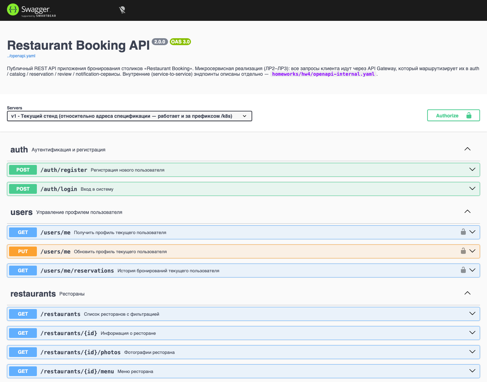
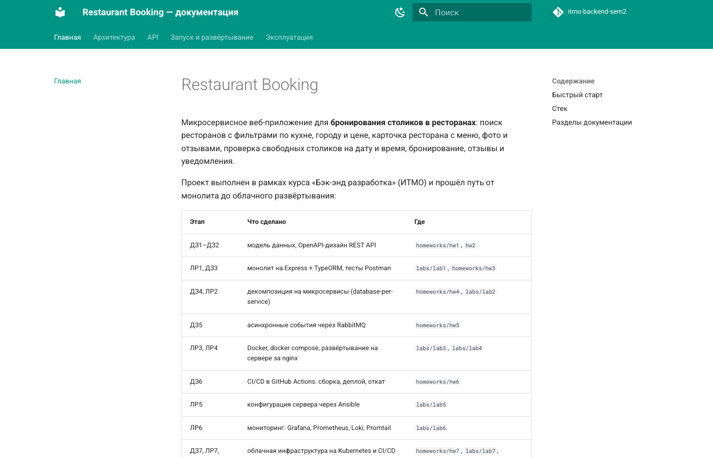
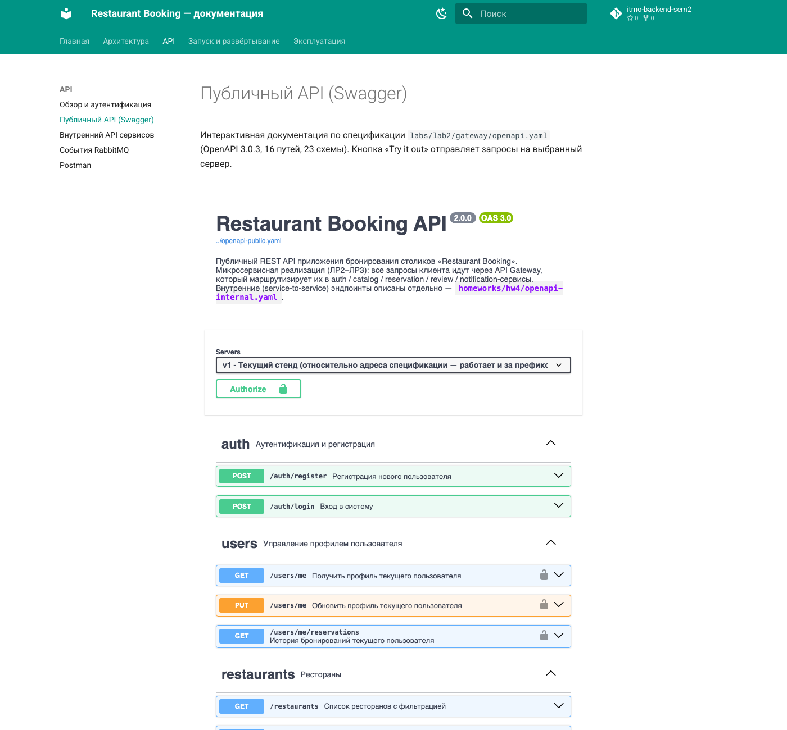
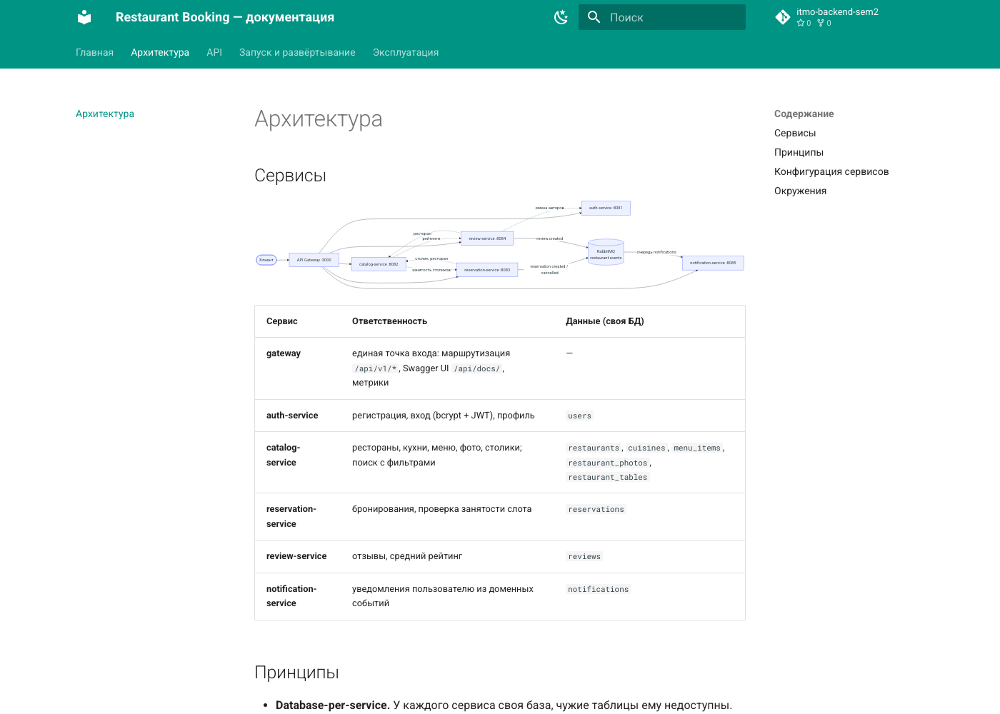

# ДЗ9. Документирование веб-приложения

**Студент:** Якшин Артемий, БР1.1
**Проект:** «Restaurant Booking» — микросервисное приложение, реализованное в рамках курса

## Задача

Задокументировать микросервисное веб-приложение средствами Postman, OpenAPI/Swagger и MkDocs.

## Ход работы

### 1. Что и для кого документируется

| Аудитория | Что ей нужно | Инструмент |
|---|---|---|
| клиент API (фронтенд, интегратор) | эндпоинты, параметры, форматы, коды ошибок, «попробовать» запрос | **OpenAPI + Swagger UI** |
| разработчик и тестировщик | готовые запросы, сквозной сценарий, проверка контракта на стенде | **Postman** (коллекция + newman) |
| команда и эксплуатация | архитектура, запуск, деплой, CI/CD, мониторинг, SLO, действия при сбоях | **MkDocs** (сайт документации) |

Все три вида документации живут в репозитории рядом с кодом. Источник истины для API один — спецификация OpenAPI в gateway: её отдаёт сам сервис, сайт MkDocs при сборке копирует её из кода, а Postman-коллекция проверяет на стенде, что поведение соответствует описанию.

### 2. OpenAPI / Swagger

**Спецификация публичного API** — `labs/lab2/gateway/openapi.yaml` (OpenAPI 3.0.3). Она развивает спецификацию из ДЗ2 до текущего состояния микросервисной системы:

- версия `2.0.0`, в описание добавлено устройство системы (gateway → сервисы) и ссылка на внутренний API;
- добавлен ресурс `notifications` (ДЗ5): путь `GET /notifications` с пагинацией и схемы `Notification` и `NotificationListResponse`;
- серверы заданы относительно: основной сервер `v1` вычисляется от адреса самой спецификации, поэтому одна и та же спецификация работает и на compose-стенде (`/api/...`), и в Kubernetes за префиксом (`/k8s/api/...`); второй сервер — `http://localhost:3000/api/v1`;
- итого 16 путей, 23 схемы, общие ответы об ошибках (`BadRequest`, `Unauthorized`, `Forbidden`, `NotFound`) и схема безопасности `bearerAuth` (JWT).

**Внутренний API** (service-to-service, `/internal/*` с ключом `X-Internal-Key`) описан отдельной спецификацией `homeworks/hw4/openapi-internal.yaml`. Наружу эти эндпоинты не выставляются, поэтому в публичную спецификацию они не входят.

**Swagger UI встроен в gateway** (`swagger-ui-express`, ЛР4) и есть на каждом стенде:

| Стенд | Swagger UI | Спецификация |
|---|---|---|
| локально | `http://127.0.0.1:3000/api/docs/` | `/api/openapi.yaml` |
| сервер (compose) | `http://<SERVER_IP>:8088/api/docs/` | `/api/openapi.yaml` |
| Kubernetes | `http://<SERVER_IP>:8088/k8s/api/docs/` | `/k8s/api/openapi.yaml` |

```ts
// gateway/src/index.ts
app.get('/api/openapi.yaml', (_req, res) => res.type('application/yaml').sendFile(OPENAPI_FILE));
// спецификация подгружается по относительному URL — работает и за префиксом (/k8s/api/docs/)
app.use('/api/docs', swaggerUi.serve, swaggerUi.setup(undefined, {
  customSiteTitle: 'Restaurant Booking API',
  swaggerOptions: { url: '../openapi.yaml' },
}));
```

Доступность Swagger UI проверяется smoke-тестами обоих CD-конвейеров (`GET /api/docs/ -> 200`, `GET /k8s/api/docs/ -> 200`), то есть каждый релиз выходит вместе с актуальной документацией API.



### 3. Postman

Коллекция ДЗ3 была одним тестовым сценарием без описаний. Для ДЗ9 собрана документированная коллекция **«Restaurant Booking API — ДЗ9»** (`postman/Restaurant Booking API.postman_collection.json`, формат v2.1):

| Папка | Запросы |
|---|---|
| 1. Аутентификация | регистрация, вход |
| 2. Профиль | мой профиль, изменить профиль |
| 3. Каталог | кухни, поиск ресторанов (все фильтры как параметры с описаниями), ресторан, меню, фото |
| 4. Бронирование | свободные столики, создать, получить, изменить бронь, мои брони |
| 5. Отзывы | оставить, отзывы ресторана, удалить |
| 6. Уведомления и отмена | уведомления (из событий RabbitMQ), отменить бронь |

Что делает коллекцию документацией, а не просто набором запросов:

- **описание** у коллекции, у каждой папки и у каждого запроса: назначение, параметры, коды ответов и когда они возникают (например, `409` — слот уже занят, `503` — catalog недоступен);
- **21 сохранённый пример ответа**, снятый реальными запросами к облачному стенду, в том числе ошибочные: `400` с ошибками валидации по полям, `401`, `404`, `409`. В Postman они видны во вкладке Examples у каждого запроса;
- **сквозной сценарий:** папки упорядочены как путь пользователя, а тесты передают данные между запросами через переменные коллекции (`token`, `restaurant_id`, `table_id`, `reservation_id`, `review_id`). Pre-request-скрипт брони выбирает случайный слот, поэтому повторные прогоны не упираются в `409`;
- **авторизация** Bearer `{{token}}` задана на уровне коллекции, а публичные запросы явно помечены `No Auth`;
- **46 проверок:** статус, время ответа и содержимое (токен выдан, статус брони `confirmed`, в уведомлениях есть `reservation.created`);
- **окружения:** `local.postman_environment.json` (docker compose) и `k8s.postman_environment.json` (облачный стенд; адрес подставляется при запуске).

Коллекция генерируется скриптом `postman/generate_collection.py`. Примеры ответов берутся с живого стенда, а адрес сервера в файлы не попадает: в коллекции только `{{base_url}}`.

**Прогон на облачном стенде** (`newman`, полный лог — `postman/newman-k8s-run.txt`):

```
$ npx newman run "Restaurant Booking API.postman_collection.json" -e k8s.postman_environment.json \
    --env-var base_url=http://<SERVER_IP>:8088/k8s/api/v1
┌─────────────────────────┬────────────────────┬───────────────────┐
│                         │           executed │            failed │
├─────────────────────────┼────────────────────┼───────────────────┤
│                requests │                 19 │                 0 │
│            test-scripts │                 19 │                 0 │
│      prerequest-scripts │                  2 │                 0 │
│              assertions │                 46 │                 0 │
├─────────────────────────┴────────────────────┴───────────────────┤
│ total run duration: 3.9s                                         │
│ average response time: 111ms [min: 96ms, max: 268ms, s.d.: 39ms] │
└──────────────────────────────────────────────────────────────────┘
```

Первые прогоны выявили ошибки в самой коллекции:

- параметры `date`/`time` у запроса столиков не попали в поле `url.query`, из которого newman собирает адрес, поэтому API ответил `400`;
- числовые переменные в JSON-теле оказались в кавычках (`"table_id": "6"`), и API отклонил строку вместо числа;
- проверка «время ответа < 1 с» срабатывала на первых запросах прогона: через VPN-туннель до стенда они шли 1–1.7 с, хотя на сервере тот же запрос обрабатывается за 3–8 мс.

Первые две ошибки исправлены в генераторе. Порог времени поднят до 3 с с явной пометкой «с учётом сети». Тестовые пользователи и брони, созданные прогонами, удалены из БД стенда.

### 4. MkDocs

Сайт документации — `docs-site/` (MkDocs 1.6 + тема Material 9.7), 14 страниц:

```
Главная — что за проект, этапы курса со ссылками на работы, быстрый старт, стек
Архитектура — сервисы (mermaid-диаграмма), принципы, переменные окружения, окружения
API
  ├── Обзор и аутентификация — базовые URL, JWT, ресурсы, формат и коды ошибок, служебные эндпоинты
  ├── Публичный API (Swagger) — интерактивная спецификация прямо на странице
  ├── Внутренний API сервисов — таблица вызовов между сервисами + Swagger внутренней спецификации
  ├── События RabbitMQ — exchange, очередь, routing keys, формат сообщений
  └── Postman — описание коллекции, скачивание, запуск через newman
Запуск и развёртывание — локально (вкладки: compose / без Docker / PostgreSQL), сервер и Ansible-роли, Kubernetes, CI/CD (sequence-диаграмма)
Эксплуатация — мониторинг и логи (дашборды, метрики, PromQL/LogQL), нагрузка и SLO, runbook
```

Использованные возможности:

- **Swagger внутри документации:** плагин `mkdocs-swagger-ui-tag` встраивает интерактивный Swagger UI для обеих спецификаций (`<swagger-ui src="openapi-public.yaml"/>`);
- **единый источник истины:** `build.sh` перед сборкой копирует спецификации из кода (`labs/lab2/gateway/openapi.yaml`, `homeworks/hw4/openapi-internal.yaml`) и коллекцию Postman. Копии в git не хранятся (`.gitignore`), поэтому документация не может разойтись с кодом;
- **диаграммы mermaid** (архитектура, схема стенда, sequence-диаграмма CI/CD) — текстом в Markdown, отрисовываются на сайте;
- поиск на русском и английском, вкладки, блоки-предупреждения (admonitions), копирование кода, светлая и тёмная темы;
- **runbook** с проверенными командами: выкатка и откат релиза, разбор недоступного сервиса и роста задержек, восстановление БД из бэкапа (команда проверена на кластере: под монтирует PVC с бэкапами, дожидается БД и читает дамп), действия после перезагрузки сервера.

**Публикация.** Workflow `.github/workflows/rb-docs.yml` по push в `main` (изменения ДЗ9 или спецификаций) собирает сайт командой `mkdocs build --strict`. Любое предупреждение (битая ссылка, страница не из nav) роняет сборку. Затем сайт публикуется в **GitHub Pages**: <https://cicada-pops.github.io/itmo-backend-sem2/>. Версии пакетов зафиксированы в `requirements.txt`.

```
rb-docs  feat(hw9): add MkDocs site, Postman docs, Pages CI   success  1m15s
pages /                                               -> 200
pages /api/public/                                    -> 200
pages /api/openapi-public.yaml                        -> 200
pages /api/restaurant-booking.postman_collection.json -> 200
pages /ops/runbook/                                   -> 200
```







### 5. Как поддерживать документацию

| Изменение | Что обновить | Что проверит |
|---|---|---|
| новый или изменённый эндпоинт | `gateway/openapi.yaml` | Swagger в gateway и на сайте обновятся сами; newman-прогон коллекции |
| новый сценарий | папка/запрос в коллекции Postman (описание, пример, тест) | `newman run` |
| изменение инфраструктуры | страница в `docs-site/docs/deploy` или `ops` | `mkdocs build --strict` в CI |

## Вывод

Микросервисное приложение задокументировано тремя взаимодополняющими средствами. **OpenAPI** — единая спецификация публичного API, которую отдаёт сам gateway вместе со Swagger UI на каждом стенде; её доступность проверяет CD при каждом релизе. Отдельно описан внутренний API сервисов. **Postman** — документированная коллекция (19 запросов, описания, 21 пример реальных ответов, 46 проверок), которая служит и справочником, и сквозным тестом контракта: прогон на облачном стенде прошёл без ошибок, а найденные в коллекции дефекты исправлены. **MkDocs** — сайт документации из 14 страниц об архитектуре, API (со встроенным Swagger), событиях, развёртывании, CI/CD, мониторинге, SLO и действиях при сбоях. Сайт собирается в strict-режиме из спецификаций, взятых прямо из кода, и автоматически публикуется в GitHub Pages.
