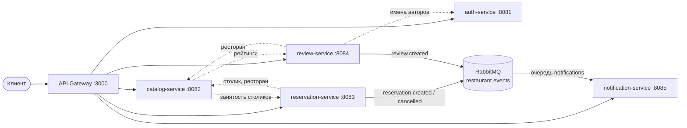

# Архитектура

## Сервисы

| Сервис | Ответственность | Данные (своя БД) |
|---|---|---|
| **gateway** | единая точка входа: маршрутизация `/api/v1/*`, Swagger UI `/api/docs/`, метрики | — |
| **auth-service** | регистрация, вход (bcrypt + JWT), профиль | `users` |
| **catalog-service** | рестораны, кухни, меню, фото, столики; поиск с фильтрами | `restaurants`, `cuisines`, `menu_items`, `restaurant_photos`, `restaurant_tables` |
| **reservation-service** | бронирования, проверка занятости слота | `reservations` |
| **review-service** | отзывы, средний рейтинг | `reviews` |
| **notification-service** | уведомления пользователю из доменных событий | `notifications` |

## Принципы

- **Database-per-service.** У каждого сервиса своя база, чужие таблицы ему недоступны. Связи между данными разных сервисов идут по идентификаторам без внешних ключей.
- **Синхронно** (REST с заголовком `X-Internal-Key`) выполняются операции, которым нужен ответ: проверка столика при брони, проверка ресторана при отзыве.
- **Асинхронно** (RabbitMQ) — побочные эффекты: уведомления. Публикация идёт по принципу best effort, и недоступность брокера не ломает ответ клиенту.
- **Мягкая деградация.** Если зависимость недоступна, обогащение пропускается (рейтинг = 0, столики «свободны»), а операции, которым нужна проверка, отвечают `503`.
- **Stateless-сервисы.** Состояние хранится только в БД и брокере, поэтому любой сервис масштабируется горизонтально (HPA, ЛР8). При старте нескольких реплик схему БД и начальные данные создаёт одна из них: она берёт `pg_advisory_lock`.
- **Наблюдаемость встроена.** Каждый сервис отдаёт `/health` (с версией релиза = SHA коммита) и `/metrics` (Prometheus) и корректно завершается по `SIGTERM`.

## Конфигурация сервисов

| Переменная | Сервисы | Назначение |
|---|---|---|
| `PORT` | все | порт HTTP |
| `DATABASE_URL` | все, кроме gateway | PostgreSQL (`postgres://…/db`); если не задана — SQLite-файл `DB_PATH` |
| `JWT_SECRET`, `JWT_EXPIRES_IN` | auth, reservation, review, notification | подпись и проверка JWT |
| `INTERNAL_API_KEY` | auth, catalog, reservation, review | ключ межсервисных вызовов |
| `RABBITMQ_URL` | reservation, review, notification | брокер событий |
| `*_URL` (`CATALOG_URL`, …) | gateway и вызывающие сервисы | адреса соседей |
| `APP_VERSION` | все | версия релиза (задаётся при сборке образа) |

## Окружения

| Окружение | Где | Вход |
|---|---|---|
| локальное | docker compose на машине разработчика | `http://127.0.0.1:3000` |
| сервер (ЛР4) | compose-стек `rb-app` на облачной ВМ | `http://<SERVER_IP>:8088/` |
| Kubernetes (ЛР7) | k3d-кластер `rb` на той же ВМ | `http://<SERVER_IP>:8088/k8s/` |
