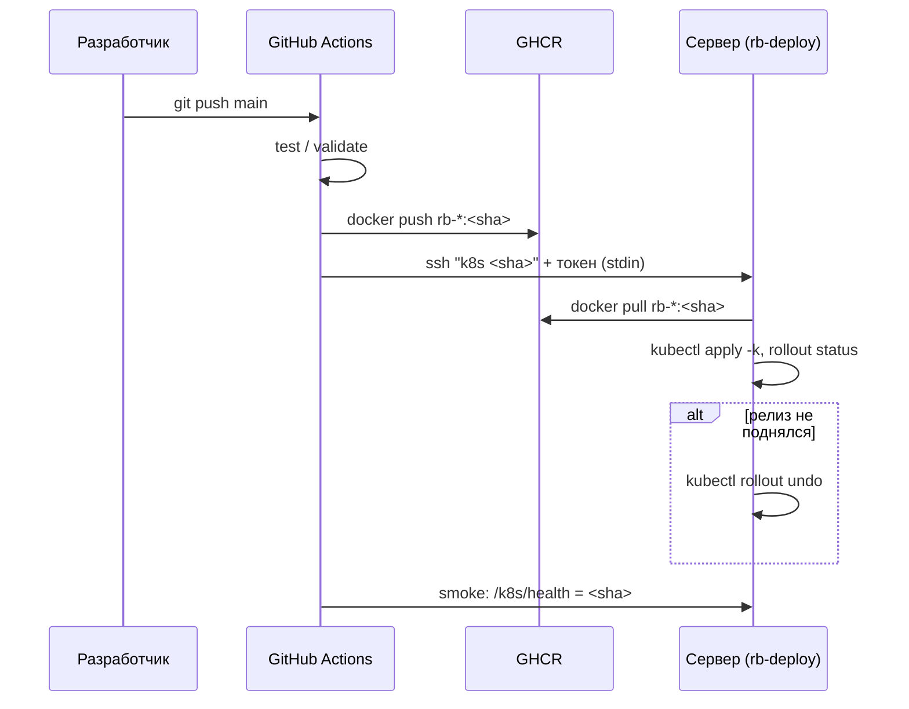

# CI/CD

Конвейеры GitHub Actions работают в публичном репозитории на GitHub-hosted раннерах.

| Workflow | Триггер | Этапы |
|---|---|---|
| `rb-deploy-compose.yml` (ДЗ6) | push в `main`: `labs/lab2/**`, `labs/lab4/deploy/**` | test (tsc ×6) → build → deploy `app <sha>` → smoke |
| `rb-deploy-k8s.yml` (ДЗ8) | push в `main`: `labs/lab2/**`, `labs/lab7/k8s/**`, `labs/lab8/k8s/**` | validate (kustomize, kubeconform 1.36, policy) → build → deploy `k8s <sha>` → smoke |
| `rb-build-images.yml` | вызывается из обоих | 6 образов → `ghcr.io/cicada-pops/rb-<service>:<sha>` |
| `rb-docs.yml` (ДЗ9) | push в `main`: `homeworks/hw9/**`, спецификации | `mkdocs build --strict` → GitHub Pages |

**Безопасность:**

- ключ CI в `authorized_keys` ограничен `restrict,command="deploy-gate.sh"`, и сервер принимает только `app|k8s <sha40>`;
- развернуть можно лишь коммит из `origin/main`;
- у CI нет доступа к Kubernetes API;
- токен реестра живёт только пока идёт job.
