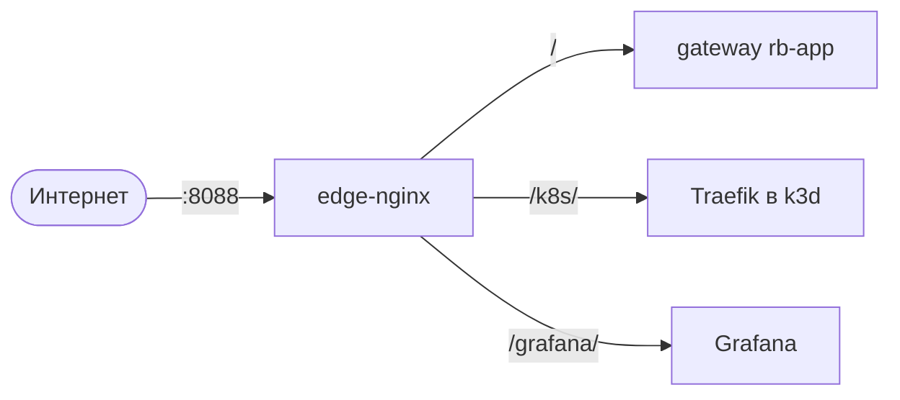

# Развёртывание на сервере (ЛР4)

Стенд работает на облачной ВМ (Ubuntu 24.04). Сервер общий, поэтому:

- всё своё лежит в `/opt/rb-sem2`, docker-ресурсы называются с префиксом `rb-`;
- контейнеры привязаны к ядрам 2–3 (`cpuset`), у всех есть лимиты памяти и CPU;
- наружу опубликован единственный порт — **8088** (edge-nginx), порты 80/443 занимает другой проект.



## Подготовка и запуск

```bash
scp labs/lab4/scripts/server-setup.sh <server>:/tmp/ && ssh <server> 'sudo bash /tmp/server-setup.sh'
```

Скрипт идемпотентный. Он доустанавливает недостающие пакеты без обновления системы, проверяет Docker, создаёт каталоги, сеть `rb-edge` и ограниченный сборщик образов `rb-builder`, клонирует репозиторий и генерирует секреты в `/opt/rb-sem2/app/.env`. То же самое умеет Ansible (ЛР5):

```bash
cd labs/lab5/ansible
ansible-playbook site.yml --check --diff
ansible-playbook site.yml
```

| Роль | Что делает |
|---|---|
| `preflight` | проверки: ОС, vCPU, Docker жив (не перезапускается), порт 8088 |
| `base` | системные пакеты (`state: present`, без upgrade) |
| `docker` | Docker Engine из официального репозитория — только на чистой ВМ |
| `stand` | каталоги, сеть, сборщик, исходники, секреты |
| `deploy_access` | пользователь CI с forced command (ДЗ6) |
| `edge` | nginx — обратный прокси |
| `app` | compose-стенд (версию задаёт CI) |
| `monitoring` | Grafana / Prometheus / Loki / Promtail (ЛР6) |
| `k3d` | Kubernetes-кластер (ЛР7) и восстановление параметров ядра хоста |
| `k8s_monitoring` | Prometheus + kube-state-metrics в кластере (ЛР8) |

## nginx

Маршруты: `/` — compose-стенд, `/k8s/` — кластер, `/grafana/` — мониторинг; `/metrics` закрыт. Имена апстримов перечитываются каждые 10 секунд (`resolver 127.0.0.11`), поэтому пересоздание контейнеров при деплое не ломает прокси. Дополнительные маршруты подключаются файлами `labs/lab4/deploy/edge/conf.d/*.conf`.
