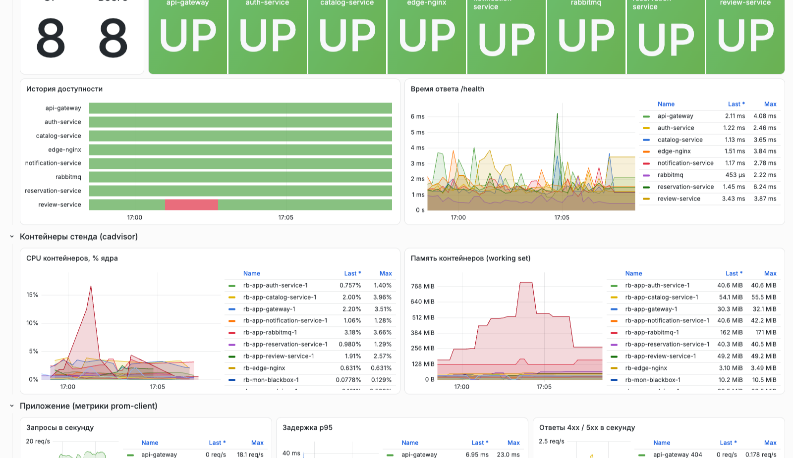
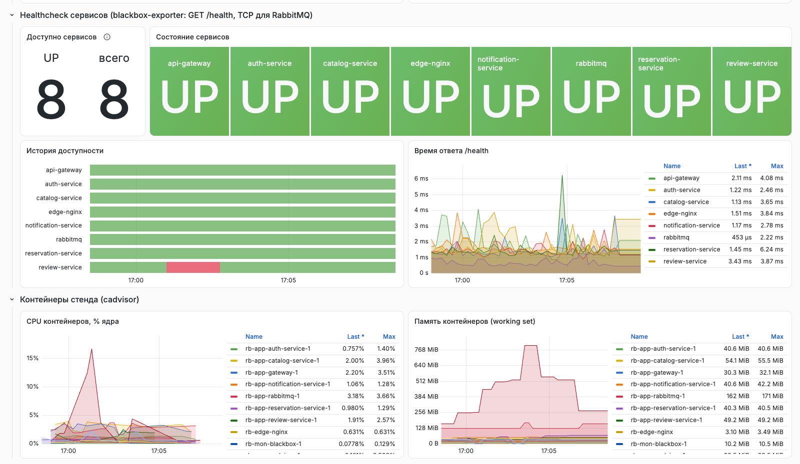
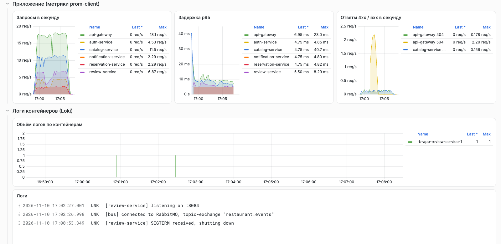
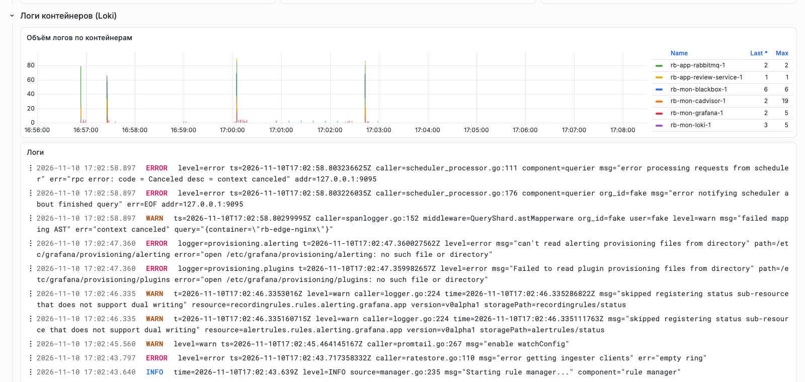

# ЛР6. Настройка системы мониторинга ресурсов

**Студент:** Якшин Артемий, БР1.1
**Проект:** «Restaurant Booking», стенд из ЛР4 (compose-проекты `rb-app`, `rb-edge`)

## Задача

Настроить мониторинг микросервисов средствами Grafana. Дашборд должен показывать:

1. общее потребление CPU, диска, RAM и сети на ВМ;
2. healthcheck всех микросервисов — доступны ли они;
3. логи всех контейнеров, запущенных на ВМ.

## Ход работы

### 1. Архитектура мониторинга

Используется связка из темы курса: **Grafana + Prometheus + Loki + Promtail**, к ней добавлены экспортёры. Все компоненты описаны в отдельном compose-проекте `rb-mon` (`monitoring/docker-compose.yml`).

```
                         ┌──────────── rb-mon (внутренняя сеть мониторинга) ────────────┐
 node-exporter ─────────►│                                                               │
 (CPU, RAM, диск ВМ)     │   Prometheus ◄── scrape 15 с ──┐                              │
 cadvisor ──────────────►│   (TSDB, 7 дней)               │                              │
 (сеть ВМ, контейнеры)   │        ▲                       │                              │
 blackbox-exporter ─────►│        │ /probe                │        Grafana ── /grafana/ ─┼──► edge-nginx :8088
 (GET /health, TCP)      │        │                       │        (дашборд из файла)    │
                         │   Loki ◄── push ── Promtail ◄──┼── Docker API (docker.sock)   │
                         └────────────────────────────────┼──────────────────────────────┘
                                                          │ сеть rb-app
                          /metrics и /health сервисов ────┘ (gateway, auth, catalog, reservation, review, notification)
```

| Компонент | Образ | Роль |
|---|---|---|
| Prometheus | `prom/prometheus:v3.15.1` | сбор и хранение метрик (retention 7 дней / 2 ГБ) |
| node-exporter | `prom/node-exporter:v1.12.1` | CPU, память, файловые системы, диск, load average ВМ |
| cAdvisor | `gcr.io/cadvisor/cadvisor:v0.55.1` | сетевой трафик ВМ и CPU/RAM каждого контейнера |
| blackbox-exporter | `prom/blackbox-exporter:v0.29.1` | healthcheck: HTTP `GET /health` сервисов, TCP-проверка RabbitMQ |
| Loki | `grafana/loki:3.7.9` | хранилище логов (single binary, TSDB-индекс, срок хранения 7 дней) |
| Promtail | `grafana/promtail:3.6.11` | сбор логов контейнеров через Docker API и отправка в Loki |
| Grafana | `grafana/grafana:13.2.5-slim` | дашборд; источники данных и дашборд создаются через provisioning |

Наружу из стека не публикуется ничего. Grafana подключена к общей сети `rb-edge` и доступна только через edge-nginx из ЛР4 по пути `/grafana/` с паролем администратора. Пароль генерируется на сервере, регистрация и анонимный доступ выключены. Маршрут добавлен отдельным файлом `labs/lab4/deploy/edge/conf.d/grafana.conf`, основной конфиг nginx не менялся.

Сервер общий, поэтому для стека действуют те же правила, что и в ЛР4: `cpuset: "2,3"`, лимиты CPU и памяти у каждого контейнера, ротация логов.

### 2. Метрики ВМ: CPU, RAM, диск, сеть

**node-exporter** работает с `pid: host` и смонтированным корнем хоста (`--path.rootfs=/host`), поэтому видит процессоры, память и файловые системы самой ВМ, а не контейнера.

С **сетью** пришлось разбираться отдельно. Без `network_mode: host` node-exporter видит только сетевое пространство имён своего контейнера, то есть трафик контейнера, а не ВМ. Host-network тут не помогает: firewall сервера (ufw, политика `INPUT DROP`) режет соединения из docker-сетей к хосту, и Prometheus не смог бы забирать метрики. Поэтому сетевой коллектор node-exporter отключён (`--no-collector.netdev`), а трафик ВМ берётся из **cAdvisor**. Для корневой cgroup (`id="/"`) он читает счётчики интерфейсов хоста. Корректность проверена сверкой с ядром:

```
# Prometheus: container_network_receive_bytes_total{id="/", interface="eth0"}
eth0 20876207920
# на хосте: /proc/net/dev, байты приёма eth0
20876220524
```

Разница в 12 КБ набежала за секунды между двумя запросами.

### 3. Healthcheck микросервисов

У каждого сервиса есть эндпоинт `/health`. **blackbox-exporter** опрашивает его каждые 15 секунд и считает сервис доступным, только если пришёл ответ `200` с телом, содержащим `"status":"ok"`. Брокер RabbitMQ HTTP-health не имеет, поэтому для него выполняется TCP-проверка порта AMQP 5672. Отдельно проверяется вход через nginx, то есть путь, которым ходят клиенты.

```yaml
# monitoring/blackbox/blackbox.yml
modules:
  http_health:
    prober: http
    timeout: 3s
    http:
      valid_status_codes: [200]
      fail_if_body_not_matches_regexp: ['"status":"ok"']
  tcp_connect:
    prober: tcp

# monitoring/prometheus/prometheus.yml (фрагмент)
  - job_name: health
    metrics_path: /probe
    params: { module: [http_health] }
    static_configs:
      - targets: ["http://rb-edge-nginx:8080/health"]
        labels: { service: edge-nginx }
      - targets: ["http://gateway:3000/health"]
        labels: { service: api-gateway }
      - targets: ["http://auth-service:8081/health"]
        labels: { service: auth-service }
      # ... catalog, reservation, review, notification
    relabel_configs:
      - { source_labels: [__address__], target_label: __param_target }
      - { source_labels: [__param_target], target_label: instance }
      - { target_label: __address__, replacement: blackbox:9115 }
```

Итог хранится в метрике `probe_success{service=...}` (1 — доступен, 0 — нет). Кроме того, Prometheus напрямую собирает `/metrics` всех шести сервисов: эндпоинт добавлен в ЛР4 через prom-client. Это даёт RPS, задержки и коды ответов приложения.

### 4. Логи контейнеров

**Promtail** находит контейнеры через Docker API (`docker_sd_configs`, сокет смонтирован только на чтение) и отправляет их stdout/stderr в **Loki** с метками `container`, `project`, `service`, `stream`:

```yaml
# monitoring/promtail/promtail.yml
scrape_configs:
  - job_name: docker
    docker_sd_configs:
      - host: unix:///var/run/docker.sock
        refresh_interval: 15s
    relabel_configs:
      - source_labels: [__meta_docker_container_name]
        regex: "/(rb-.*|k3d-rb-.*)"
        action: keep
      - { source_labels: [__meta_docker_container_name], regex: "/(.*)", target_label: container }
      - { source_labels: [__meta_docker_container_label_com_docker_compose_project], target_label: project }
      - { source_labels: [__meta_docker_container_label_com_docker_compose_service], target_label: service }
      - { source_labels: [__meta_docker_container_log_stream], target_label: stream }
```

**Ограничение, связанное с общим сервером.** На ВМ кроме стенда работают контейнеры другого проекта. Их логи и метрики — чужие данные, поэтому собираются логи только контейнеров стенда (`rb-*`) и будущего k3d-кластера ЛР7 (`k3d-rb-*`). Это обеспечивает правило `keep` в Promtail. В Prometheus для cAdvisor стоит аналогичный фильтр `metric_relabel_configs`: сохраняются серии корневой cgroup (вся ВМ) и контейнеров стенда. На машине, где работает только своё приложение, правило `keep` удаляется, и Promtail начинает собирать логи всех контейнеров. Остальная конфигурация от этого не меняется.

Проверка, что в хранилищах нет чужих данных:

```
count({job="cadvisor", name!="", name!~"rb-.*|k3d-rb.*"}) → []   # Prometheus: серий не своих контейнеров нет
GET loki/api/v1/label/container/values →
  rb-app-auth-service-1, rb-app-catalog-service-1, rb-app-gateway-1, rb-app-notification-service-1,
  rb-app-rabbitmq-1, rb-app-reservation-service-1, rb-app-review-service-1, rb-edge-nginx,
  rb-mon-blackbox-1, rb-mon-cadvisor-1, rb-mon-grafana-1, rb-mon-loki-1, rb-mon-node-exporter-1,
  rb-mon-prometheus-1, rb-mon-promtail-1
```

### 5. Grafana: provisioning и дашборд

Источники данных (Prometheus, Loki) и дашборд не создаются вручную в UI, а лежат файлами в репозитории и подключаются при старте:

- `grafana/provisioning/datasources/datasources.yml` — два источника с фиксированными `uid`;
- `grafana/provisioning/dashboards/dashboards.yml` — провайдер, читающий JSON из `grafana/dashboards/`;
- `grafana/dashboards/rb-overview.json` — дашборд «Restaurant Booking — ВМ, сервисы, логи» (25 панелей). Он же назначен домашним (`GF_DASHBOARDS_DEFAULT_HOME_DASHBOARD_PATH`).

| Блок дашборда | Панели | Запрос (основной) |
|---|---|---|
| **ВМ** | CPU, RAM, диск `/` (gauge), сеть вход/выход, load average | `100*(1-avg(rate(node_cpu_seconds_total{mode="idle"}[…])))`, `1 - MemAvailable/MemTotal`, `1 - avail/size{mountpoint="/"}`, `rate(container_network_receive_bytes_total{id="/",interface="eth0"}[…])*8` |
| | CPU по режимам, память, сеть, дисковый ввод-вывод (графики) | `avg by (mode)(rate(node_cpu_seconds_total…))`, `rate(node_disk_read_bytes_total…)` |
| **Healthcheck** | «Доступно сервисов N из M», плитки UP/DOWN по каждому сервису, история доступности (state timeline), время ответа `/health` | `sum(probe_success{job=~"health.*"})`, `max by (service)(probe_success…)`, `probe_duration_seconds` |
| **Контейнеры стенда** | CPU и память каждого контейнера | `rate(container_cpu_usage_seconds_total{name=~"rb-.*"}[…])`, `container_memory_working_set_bytes` |
| **Приложение** | RPS, задержка p95, ответы 4xx/5xx по сервисам | `histogram_quantile(0.95, sum by (le,service)(rate(http_request_duration_seconds_bucket[…])))` |
| **Логи** | объём логов по контейнерам, панель логов с фильтром по контейнеру и полнотекстовым поиском | `{container=~"$container"} \|~ "(?i)$search"` |

### 6. Развёртывание

Стек разворачивается Ansible-ролью `monitoring`, добавленной в проект ЛР5 (`labs/lab5/ansible/roles/monitoring`). Роль:

- копирует `labs/lab6/monitoring` в `/opt/rb-sem2/mon`;
- один раз генерирует пароль Grafana в `.env` (права `0600`);
- запускает `docker compose up --wait`;
- при изменении конфигурации перезапускает стек через handler;
- проверяет, что у Prometheus нет целей не в состоянии `up`.

Маршрут `/grafana/` раскатывает роль `edge`.

```
$ ansible-playbook site.yml --tags edge,monitoring --diff
TASK [edge : Дополнительные маршруты conf.d/*.conf]
changed: [rb-server] => (item=…/labs/lab4/deploy/edge/conf.d/grafana.conf)
TASK [monitoring : Каталог стека мониторинга] ............................ changed
TASK [monitoring : Конфигурация стека из репозитория (labs/lab6/monitoring)] changed
TASK [monitoring : Секреты Grafana (пароль генерируется один раз; …)] ..... changed
TASK [monitoring : Стек мониторинга запущен] ............................. changed
TASK [monitoring : Сводка по целям Prometheus]
ok: [rb-server] => msg: {cadvisor: 1, health: 7, health-tcp: 1, node: 1, prometheus: 1, services: 6}
RUNNING HANDLER [edge : Reload edge nginx] ............................... changed
RUNNING HANDLER [monitoring : Restart monitoring stack] .................. changed
PLAY RECAP
rb-server : ok=17  changed=7  unreachable=0  failed=0
```

Все 17 целей Prometheus в состоянии `up`. Перед проверкой все конфиги прогнаны штатными валидаторами: `promtool check config`, `loki -verify-config`, `promtail -check-syntax`, `blackbox_exporter --config.check`, `nginx -t`.

При запуске нашлись и были исправлены две проблемы:

- **Grafana 13 без источников данных.** Сначала все панели показывали ошибку «plugin not registered». В Grafana 12+ встроенные источники Prometheus и Loki вынесены в отдельные плагины, которые ставятся при первом старте (preinstall), а я отключил предустановку переменной `GF_PLUGINS_PREINSTALL_DISABLED`. После удаления переменной оба источника прошли проверку (`/api/datasources/uid/…/health`: `Successfully queried the Prometheus API`, `Data source successfully connected`);
- **лимит памяти Grafana.** С предустановленными плагинами Grafana заняла 252 МБ из выставленных 256 МБ, и лимит поднят до 384 МБ.

### 7. Проверка на работающем стенде

Чтобы на дашборде были содержательные данные, к стенду 8 минут подавался лёгкий фоновый трафик: k6, 4 виртуальных пользователя, по циклу «список ресторанов → карточка → меню → отзывы → столики → кухни → профиль → уведомления» с паузой 1 с. Посередине прогона в 17:00:53 UTC был вручную остановлен `review-service`, а в 17:02:26 запущен снова, чтобы проверить, как healthcheck реагирует на отказ.

```
$ k6 run -e BASE=http://<SERVER_IP>:8088 scripts/lab6_traffic.js   # 4 VU, 8 мин
    checks_succeeded...: 100.00% 1027 out of 1027
    http_req_duration..: avg=108.79ms p(95)=130.06ms p(99)=440.61ms   # с учётом сети до сервера (~100 мс RTT)
    http_req_failed....: 3.03%  251 out of 8271                        # намеренные 404 + отзывы во время остановки
    http_reqs..........: 8271   17.02/s
$ docker stop rb-app-review-service-1    # 17:00:53 UTC
$ docker start rb-app-review-service-1   # 17:02:26 UTC
```

**ВМ.** CPU, RAM и диск показаны gauge-панелями и графиками по режимам. Сеть отображается графиком приёма и передачи интерфейса `eth0` (передача отложена вниз), диск — графиком чтения и записи. Пик сетевого трафика около 17:00 — это загрузка плагинов Grafana при первом старте.



**Healthcheck.** Во время эксперимента панель «Доступно сервисов» показала 7 из 8, плитка `review-service` стала красной (`DOWN`). На «Истории доступности» виден красный отрезок ровно в окне остановки 17:01–17:02. Остальные сервисы, включая gateway, оставались доступными: отказ одного сервиса не обрушил систему, и это подтверждает «мягкую деградацию» из ЛР2. Время ответа `/health` всех сервисов — 1–6 мс. Ниже на том же кадре CPU и память каждого контейнера стенда.



**Приложение и логи.** По метрикам prom-client видно RPS по сервисам (gateway до 18 запросов/с), задержку p95 внутри сервера (gateway до 23 мс, catalog до 41 мс: он сам ходит в review и reservation) и ответы с ошибками. Пока `review-service` был остановлен, gateway отвечал `504` на запросы отзывов (до 2.2 в секунду), а 404 — это намеренные запросы к несуществующему ресторану. Причина отказа видна в логах: `[review-service] SIGTERM received, shutting down` в 17:00:53 и `listening on :8084` с повторным подключением к RabbitMQ в 17:02:27.



Панель логов позволяет выбрать любые контейнеры (переменная «Контейнер») и искать по тексту (переменная «Поиск в логах», регистронезависимое регулярное выражение). Ниже показаны логи всех контейнеров приложения и мониторинга за окно 16:56–17:08 с уровнями и разбивкой объёма по контейнерам. Контейнер nginx на этом кадре скрыт, потому что в его access-логе видны IP-адреса клиентов.



Потребление ресурсов стеком мониторинга после запуска (`docker stats`): Grafana ~250–300 МБ (лимит 384 МБ), Promtail 38 МБ, Prometheus 41 МБ, Loki 33 МБ, cAdvisor 19 МБ, node-exporter и blackbox по 7 МБ. Всего около 400 МБ.

## Вывод

Для микросервисного приложения настроена система мониторинга на связке Grafana + Prometheus + Loki + Promtail. Метрики ВМ собираются node-exporter'ом (CPU, память, диск) и cAdvisor'ом (сетевой трафик хоста, ресурсы контейнеров). Корректность сетевых метрик подтверждена сверкой с `/proc/net/dev`. Доступность всех сервисов, брокера и входа через nginx проверяется blackbox-exporter'ом каждые 15 секунд. Логи контейнеров собираются Promtail через Docker API и доступны в Grafana с фильтром по контейнеру и полнотекстовым поиском. Источники данных и дашборд описаны кодом (provisioning), а весь стек разворачивается Ansible-ролью. Эксперимент с остановкой сервиса показал, что дашборд сразу отражает отказ и восстановление, а причину видно в логах. Так как сервер общий, мониторинг собирает данные только о своих контейнерах и ВМ в целом, наружу доступен только через nginx с авторизацией и ограничен по ресурсам.
