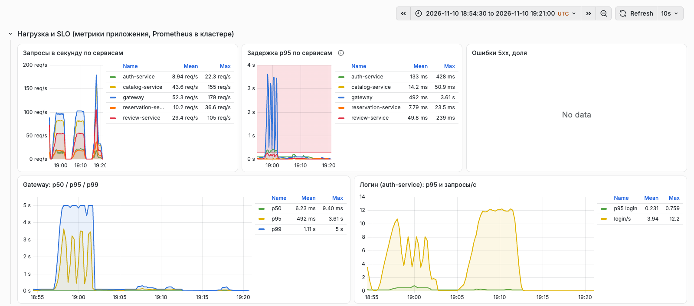
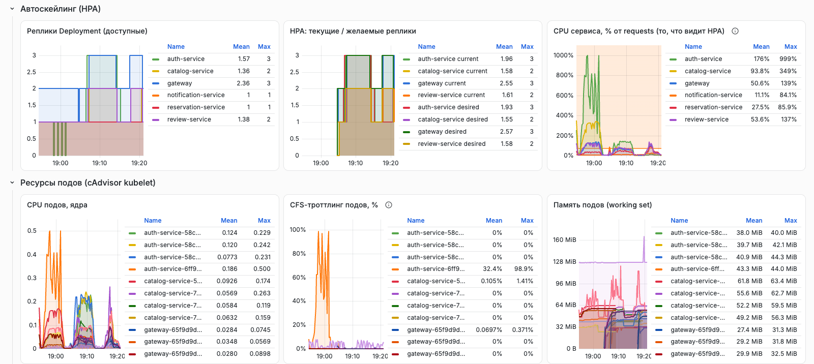
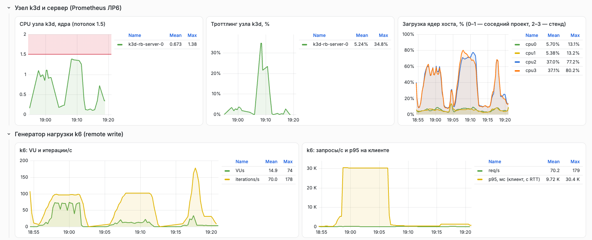

# ЛР8. Нагрузочное тестирование облачной инфраструктуры и настройка автоскейлинга

**Студент:** Якшин Артемий, БР1.1
**Проект:** «Restaurant Booking»; стенд — Kubernetes-кластер из ЛР7, сценарии нагрузки — ДЗ10

## Задача

1. Провести нагрузочные испытания развёрнутого в облаке приложения.
2. Проанализировать в Grafana графики загрузки ресурсов, время отклика и узкие места.
3. Настроить автоматическое масштабирование подов (Horizontal Pod Autoscaler) в Kubernetes.
4. Оптимизировать и настроить лимиты ресурсов (requests / limits).

## Ход работы

### 1. Стенд и инструменты

| Компонент | Параметры |
|---|---|
| Кластер | k3s v1.36.6 в k3d, 1 узел, потолок **1.5 CPU** и **2.5 ГиБ** (cgroup контейнера узла), ядра хоста 2–3 |
| Приложение | 6 Deployment (gateway ×2, остальные ×1), PostgreSQL и RabbitMQ — StatefulSet (ЛР7) |
| Исходные ресурсы | все сервисы: `requests: 50m / 96Mi`, `limits: 500m / 192Mi` |
| Генератор | k6 v1.5 на рабочем ноутбуке, путь до стенда откалиброван (ДЗ10: 200 RPS без ошибок, RTT ~96 мс) |
| Метрики | Prometheus **внутри кластера** (новый, `labs/lab8/k8s/monitoring`) + Prometheus ЛР6 на хосте |

**Мониторинг кластера.** Для анализа нужны метрики, которых нет у стека ЛР6: CPU и троттлинг каждого пода, реплики, HPA, requests и limits. Поэтому в пространство `monitoring` развёрнуты (Ansible-роль `k8s_monitoring`):

- **Prometheus** v3.15 (ServiceAccount + ClusterRole на чтение `nodes/proxy`, `pods`, `endpoints`). Он собирает:
  - `/metrics` подов по аннотациям `prometheus.io/*` (RPS и задержки prom-client);
  - **cAdvisor kubelet** через прокси API-сервера (`/api/v1/nodes/<node>/proxy/metrics/cadvisor`), оставляя только CPU, CFS-троттлинг, память и сеть;
  - **kube-state-metrics** v2.20 (реплики, HPA, requests/limits; только пространство `rb`).

  Включён приём **remote write**: k6 отправляет туда свои метрики через SSH-туннель. Наружу Prometheus доступен только как NodePort 30090 в docker-сети `rb-edge`, где его читает Grafana ЛР6 (второй источник данных `Prometheus (k8s)`);
- **дашборд** «Restaurant Booking — Kubernetes: нагрузка и автоскейлинг» (`labs/lab6/monitoring/grafana/dashboards/rb-k8s-load.json`, 21 панель): RPS и p50/p95/p99 по сервисам, логины, реплики и решения HPA, CPU сервисов в % от requests (то, что видит HPA), CPU, троттлинг и память подов, CPU узла k3d относительно потолка 1.5 и загрузка каждого ядра хоста, метрики k6.

**Безопасность общего сервера.** На время прогонов compose-стенд ЛР4 остановлен, чтобы освободить память и ядра 2–3. На сервере работал **страж** (`guard.sh`): раз в 5 с он записывал загрузку ядер 0–1 (соседний проект), доступную память, число unhealthy-контейнеров соседа, рестарты узла k3d и значения `kernel.panic_on_oops` и `vm.overcommit_memory`. Пороги аварийной остановки k6: MemAvailable < 700 МБ, рост unhealthy у соседа, рестарт узла. Генератор проверял флаг стража каждые 15 с.

### 2. Испытания в исходной конфигурации

Сценарии и профили взяты из ДЗ10 (`homeworks/hw10/k6`). Сначала стенд нагружен как есть: по одной реплике сервисов (gateway ×2), у всех `requests 50m`, `limits 500m`, автоскейлинга нет.

| Прогон | Нагрузка | Ошибки | Сервер: gateway p95 / p99 | Наблюдение |
|---|---|---|---|---|
| `load` | ~50 запросов/с, 5 мин | 0 % | 28 / 91 мс | SLO с запасом в 10 раз; все сервисы вместе ~0.4 CPU |
| `stress` | чтение до 200/с, вход до 6/с, 8 мин | 0 % | 71 / 160 мс на пике ~184/с | узел до 1.28 CPU; **auth упирается в лимит 500m, троттлинг 15 %** |
| `hpa` ×1.5 (**фаза A**) | вход 12/с + чтение 90/с, 6.5 мин | **0.76 %** | **2700 / ≥5000 мс** | вход: медиана 2.7 с, p95 30 с (таймаут) |

**Анализ фазы A в Grafana** (левая половина графиков ниже, 18:55–19:02):

- **auth-service — узкое место.** CPU пода прижат к `limits.cpu`: 0.50 из 0.50 ядра. CFS-троттлинг 66.6 % (на графике до 99 %), то есть в двух периодах из трёх контейнер исчерпывал квоту и простаивал. bcrypt занимает ~40–50 мс CPU на вход, и 12 входов в секунду требуют ~0.6 ядра. Одна реплика с лимитом 0.5 физически не справляется;
- **очередь, а не медленная обработка.** Сам auth отвечает с p95 468 мс, но запросы ждут в очереди перед его event loop. Поэтому gateway видит p95 2.7 с и p99 ≥ 5 с, а k6 — таймауты по 30 с (ошибки `504` от nginx);
- **каскад:** review-service при выдаче отзывов запрашивает у auth имена авторов, и его p95 вырос с 5 до 187 мс, хотя сам он не нагружен;
- **ёмкость узла не исчерпана:** узел k3d загружен на 1.11 CPU из 1.5. Проблема в том, как распределены ресурсы между подами, а не в нехватке ёмкости. Классический случай для горизонтального масштабирования и пересмотра лимитов.

### 3. Оптимизация requests / limits

Исходные значения (`50m / 500m` у всех) ничего не говорили планировщику и HPA о реальном профиле нагрузки. Новые значения выведены из измерений (`labs/lab8/k8s/autoscaling/resources.yaml`):

| Сервис | Потребление: номинал → пик | requests CPU / RAM | limits CPU / RAM | Обоснование |
|---|---|---|---|---|
| gateway | 0.04 → 0.09 ядра на под, 30 МиБ | 75m / 80Mi | 500m / 160Mi | на номинале 53 % от requests (ниже цели HPA 70 %) |
| auth-service | 0.10 → 0.50+ ядра, 42 МиБ | 150m / 80Mi | **1** / 160Mi | всплески bcrypt; Node.js однопоточен, лимит 500m давал троттлинг 15–67 % |
| catalog-service | 0.10 → 0.28 ядра, 63 МиБ | 150m / 96Mi | **1** / 192Mi | ~1.6–2.3 мс CPU на запрос, самый частый вызов |
| review-service | 0.04 → 0.10 ядра, 56 МиБ | 50m / 80Mi | 500m / 160Mi | — |
| reservation-service | 0.02 → 0.04 ядра, 57 МиБ | 50m / 80Mi | 500m / 160Mi | нагрузка мала, HPA не нужен |
| notification-service | 0.005–0.01 ядра, 40 МиБ | 25m / 64Mi | 250m / 128Mi | только обработка событий |

Принципы:

1. **requests ≈ потребление на номинальной нагрузке** (50 RPS). Тогда HPA с целью 70 % включается при 1.4–2-кратной нагрузке, а не постоянно и не слишком поздно.
2. **Σ(requests × maxReplicas) ≤ реального потолка узла.** Kubelet видит 4 ядра хоста (cgroup-ограничение 1.5 ему не видно), поэтому планировщик не остановит избыточное масштабирование. Сумма считалась вручную: 1.35 ядра на сервисы + 0.06 на мониторинг ≤ 1.5.
3. **CPU-лимиты у CPU-ёмких однопоточных сервисов = 1 ядро.** Лимит ниже ядра означает троттлинг на всплесках при свободном узле. Справедливое деление CPU между подами задают requests (веса CFS), а лимит лишь отсекает аварийный случай.
4. **Память — по факту ×2–2.5.** Рабочий набор ≤ 64 МиБ. Узел ограничен 2.5 ГиБ, поэтому завышенные requests памяти помешали бы разместить дополнительные реплики.

### 4. Horizontal Pod Autoscaler

HPA оформлен kustomize-компонентом `labs/lab8/k8s/autoscaling` и подключён к `overlays/prod`. Поэтому он выкатывается обычным конвейером ДЗ8 (коммит `a7ae666` → validate → build → deploy).

```yaml
apiVersion: autoscaling/v2
kind: HorizontalPodAutoscaler
metadata: { name: auth-service }
spec:
  scaleTargetRef: { apiVersion: apps/v1, kind: Deployment, name: auth-service }
  minReplicas: 1
  maxReplicas: 3
  metrics:
    - type: Resource
      resource: { name: cpu, target: { type: Utilization, averageUtilization: 70 } }
  behavior:
    scaleUp:   { stabilizationWindowSeconds: 0,   policies: [{ type: Pods, value: 2, periodSeconds: 30 }] }
    scaleDown: { stabilizationWindowSeconds: 120, policies: [{ type: Pods, value: 1, periodSeconds: 60 }] }
```

| Deployment | min–max | Цель |
|---|---|---|
| gateway | 2–3 | CPU 70 % от requests |
| auth-service | 1–3 | то же |
| catalog-service | 1–2 | то же |
| review-service | 1–2 | то же |

Источник метрик — встроенный в k3s **metrics-server**. Масштабирование вверх происходит без задержки, по 2 пода за 30 с. Вниз — только после 120 с стабильно низкой нагрузки и по 1 поду в минуту, чтобы не «дёргаться» на коротких провалах.

**Важная деталь.** У Deployment'ов под управлением HPA из манифеста удалено поле `spec.replicas` (JSON-patch `remove` в компоненте). Иначе каждый `kubectl apply` из CD сбрасывал бы число реплик, выставленное HPA. При первой выкатке это вызвало ожидаемый переходный эффект: gateway на секунды опустился до 1 реплики, и HPA сразу вернул минимум (`New size: 2; reason: Current number of replicas below Spec.MinReplicas`). Предупреждения `FailedGetResourceMetric` в первые ~30 с после создания HPA означают лишь, что у только что созданных объектов ещё нет метрик.

### 5. Испытания с автоскейлингом (фаза C)

Тот же профиль `hpa ×1.5`, что и в фазе A:

```
          фаза A (без HPA)                        фаза C (HPA + тюнинг)
checks....: 99.23% 31236 / 31476               100.00% 32740 / 32740
login.....: med=2.71s  p(95)=30.09s ✗          med=167.08ms p(95)=403.74ms ✓
read......: p(95)=271.51ms p(99)=506.35ms      p(95)=271.58ms p(99)=569.8ms
failed....: 0.76%  240 out of 31476            0.00%  0 out of 32740
```

| Показатель (сервер, устойчивая фаза 4 мин) | Фаза A | Фаза C |
|---|---|---|
| gateway p95 / p99 | 2700 / ≥ 5000 мс | **88 / 182 мс** |
| вход p95 (auth) | 468 мс + очередь | **150 мс** |
| auth: обработано запросов/с | 14.2 (часть отвалилась по таймауту) | **21.5** (весь поток) |
| auth: CPU / троттлинг | 0.33 (пик 0.50 = лимит) / **66.6 %** | 0.60 на 3 пода / **0 %** |
| review p95 (каскад от auth) | 187 мс | 21 мс |
| реплики auth / catalog / gateway / review | 1 / 1 / 2 / 1 | **3 / 2 / 3 / 2** |
| CPU узла k3d (макс.) | 1.11 из 1.5 | 1.38 из 1.5 |

Хронология решений HPA (журнал `kubectl get hpa` каждые 5 с и события `SuccessfulRescale`):

```
19:05:17  старт нагрузки (рост до 12 входов/с и 90 чтений/с за 2 мин)
19:06:12  auth-service     New size: 2   (cpu 112 % от requests)
19:06:27  auth-service     New size: 3   (cpu 174 %)
19:06:42  review-service   New size: 2   (cpu 84 %)
19:06:57  catalog-service  New size: 2   (cpu 88 %);  gateway New size: 3 (cpu 78 %)
19:11:47  конец нагрузки
19:13:42  gateway          New size: 2   (All metrics below target; окно стабилизации 120 с)
19:13:57  auth-service 2, catalog-service 1, review-service 1
19:14:57  auth-service     New size: 1
```





Автоскейлинг вместе с новыми лимитами устранил узкое место. Когда auth вышел на 3 реплики без троттлинга, ушли очередь, таймауты и каскад на review. Нагрузка выросла, но система снова в SLO (вход p95 150 мс на сервере против цели 600 мс). Узел при этом загружен на 1.38 из 1.5 CPU, то есть HPA довёл кластер почти до его потолка.

### 6. Всплеск нагрузки (spike)

Профиль `spike` с включённым HPA: фон 30 запросов/с, за 10 с рост до 180/с на одну минуту, затем возврат.

```
checks....: 100.00% 18671 / 18671     failed: 0.00%
read......: p(95)=361.89ms p(99)=789.65ms
write.....: p(95)=627.04ms ✗ (порог 600 мс)
19:16:35  начало всплеска
19:17:12  HPA: catalog→2, gateway→3, review→2 (решение)
19:17:30  новые поды в работе
```

Ошибок нет, задержки чтения в пределах SLO, но p95 записи во время всплеска вышла за порог. HPA принял решение через 37 с после начала всплеска, а новые поды начали обслуживать запросы через 55 с, когда минутный всплеск почти закончился. Это предел **реактивного** автоскейлинга: к задержке складываются период сбора метрик metrics-server, цикл контроллера HPA (15 с) и старт пода. Для коротких всплесков нужен запас: повышенный `minReplicas` в часы пик, масштабирование по RPS или длине очереди (KEDA) или плановое масштабирование.

### 7. Узел, сервер и безопасность соседнего проекта



Загрузка ядер хоста показывает изоляцию: под нагрузкой загружены ядра 2–3 (до 77–80 %), ядра 0–1 остаются на фоновом уровне соседнего проекта. Журнал стража по прогонам:

| Прогон | Ядра 0–1, среднее | MemAvailable, минимум | Unhealthy у соседа | Рестарты узла | Остановок |
|---|---|---|---|---|---|
| load | 3 % / 3 % | 3998 МБ | 1 (исходно 1) | 0 | нет |
| stress | 4 % / 4 % (макс. 10 %) | 3925 МБ | 1 | 0 | нет |
| hpa, фаза A | 4 % / 3 % | 3887 МБ | 1 | 0 | нет |
| hpa, фаза C | 5 % / 4 % | 3713 МБ | 1 | 0 | нет |
| spike | 4 % / 4 % | 3711 МБ | 1 | 0 | нет |

После всех прогонов `kernel.panic_on_oops=0` и `vm.overcommit_memory=0` (узел ни разу не перезапускался, kubelet их не перезаписал). Тестовые данные удалены: 15 пользователей `*@load.test`, 982 брони и 1964 уведомления. Compose-стенд ЛР4 снова запущен.

**Ещё одна находка — мониторинг тоже нужно рассчитывать на нагрузку.** При первом открытии дашборда ЛР8 (21 панель за 25 минут) Grafana упёрлась в свой лимит 384 МБ и была убита OOM-killer'ом внутри своей cgroup:

```
kernel: Memory cgroup out of memory: Killed process 2298700 (grafana) total-vm:2099552kB, anon-rss:364828kB
kernel: oom-kill:constraint=CONSTRAINT_MEMCG ...
```

Лимит сработал как задумано: пострадал только контейнер Grafana. Лимит поднят до 512 МБ, при повторной загрузке того же дашборда Grafana заняла 383 МБ без рестартов.

### 8. Итоги и рекомендации

1. **Узким местом системы оказался вход** (bcrypt, ~40–50 мс CPU на запрос). Его решает горизонтальное масштабирование auth-service. Для production разумно вынести хэширование в пул потоков (нативный `bcrypt` вместо `bcryptjs`) или снизить cost-фактор, чтобы вход не блокировал event loop.
2. **CPU-лимиты ниже ядра у однопоточных сервисов вредны:** троттлинг 15–67 % при свободном узле. requests задают справедливое деление, а лимит лучше оставлять на уровне ядра.
3. **HPA справляется с нарастающей нагрузкой** (за ~2 мин система вышла на нужный масштаб и вернулась в SLO), но **не успевает за минутными всплесками**. Нужен запас по `minReplicas` или масштабирование по опережающим метрикам.
4. **Потолок одного узла** (1.38 из 1.5 CPU в фазе C) — предел горизонтального масштабирования подов. Дальше нужны новые узлы: в варианте B из ДЗ7 это Cluster Autoscaler группы узлов.

## Вывод

Проведены нагрузочные испытания облачного стенда: номинальная нагрузка, ступенчатый стресс, CPU-ёмкая нагрузка для проверки автоскейлинга и всплеск. Генератор k6 работал вне сервера, его метрики шли в Prometheus кластера, а безопасность соседнего проекта контролировал страж. Графики Grafana (новый Prometheus в кластере, kube-state-metrics, cAdvisor kubelet) показали узкое место: auth-service на CPU-ёмкой операции входа упирался в лимит 500m (троттлинг до 67 %). Из-за этого росла очередь, а через межсервисный вызов задержки переходили на review-service, хотя узел оставался недогружен. По измерениям пересмотрены requests и limits всех сервисов и настроен HPA для четырёх сервисов, а выкатка прошла через CD-конвейер. На той же нагрузке HPA за две минуты масштабировал auth до трёх реплик и остальные сервисы до максимума. Ошибки ушли с 0.76 % до нуля, p95 через gateway снизилась с 2.7 с до 88 мс, вход вернулся в SLO, троттлинг исчез. Spike-тест выявил ограничение реактивного автоскейлинга на минутных всплесках, а фаза C — потолок одного узла. Для обоих ограничений даны рекомендации.

