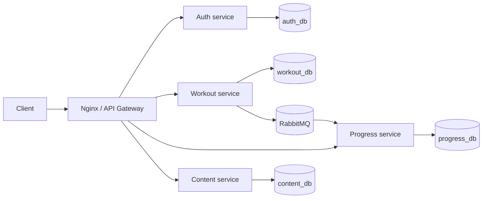

# ДЗ 4. Архитектура микросервисов FitFlow

## Декомпозиция

| Сервис | Ответственность | Собственная БД |
|---|---|---|
| `auth-service` | регистрация, вход, профиль, роли, выпуск JWT | `auth_db`: `users` |
| `workout-service` | каталог тренировок и личные планы | `workout_db`: `workouts`, `training_plans`, `plan_workouts` |
| `progress-service` | история выполнений, агрегаты и проекция тренировок | `progress_db`: `progress_entries`, `workout_snapshots` |
| `content-service` | статьи | `content_db`: `articles` |

Я применил database-per-service: сервис не читает таблицы другого сервиса и не использует межбазовые внешние ключи. `userId` и `workoutId` в чужой БД — логические UUID. Имена в таблице обозначают владельцев; в Compose каждый отдельный PostgreSQL-контейнер содержит базу `fitflow`.

## Синхронные взаимодействия

Клиент обращается к сервисам через Nginx/API Gateway с единым внешним префиксом `/api/v1`:

- `/api/v1/auth/*` → auth;
- `/api/v1/workouts/*`, `/api/v1/plans/*` → workout;
- `/api/v1/progress/*` → progress;
- `/api/v1/articles/*` → content.

Каждый сервис самостоятельно проверяет подпись JWT общим симметричным секретом `JWT_SECRET`. Асимметричная подпись и JWKS — возможное развитие, не текущая реализация.

## Асинхронные взаимодействия

RabbitMQ exchange `fitflow.events` типа `topic`, durable messages:

| Событие | Издатель | Потребитель | Назначение |
|---|---|---|---|
| `workout.created` | workout | progress | обновление локальной проекции допустимых тренировок |

Конверт события: `id`, `type`, `occurredAt`, `payload`. Я реализовал только `workout.created`. Потребитель делает upsert по ID тренировки и сохраняет `sourceEventId`; отдельного журнала дедупликации по `event.id` нет. После записи он отправляет ack, при ошибке — nack без повторной постановки. Retry, DLQ, transactional outbox и publisher confirms не реализованы. События удаления пользователей и тренировок остаются предложениями по развитию.

## Отказоустойчивость и согласованность

- локальная транзакция ограничена одной БД;
- межсервисные изменения имеют eventual consistency;
- `/health` сообщает только liveness; проверки readiness БД/RabbitMQ нет;
- запись тренировки и отправка события не атомарны: при сбое между операциями событие может потеряться;
- автоматического reconnect, retry и DLQ нет;
- проекция обновляется только при создании, изменения и удаления не синхронизируются;
- проверка проекции включается через `REQUIRE_KNOWN_WORKOUT=true`; текущий Compose её не включает.

## Безопасность

Я передаю секреты через окружение. Node.js-приложения в образе работают без root, административные маршруты проверяют роль, порты БД не публикуются наружу. Используется console; структурированные логи, correlation ID и систематическое маскирование чувствительных полей пока не реализованы. Учебные секреты по умолчанию необходимо заменить перед эксплуатацией.
