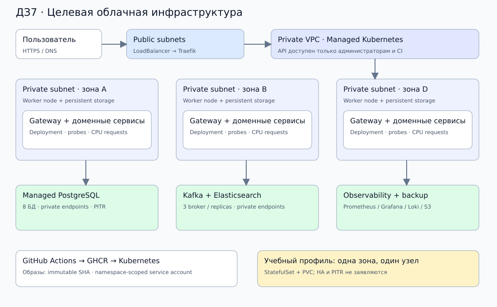

# Задача

Спроектировать ресурсы, сеть и восстановление облачного стенда авторизации.

# Исходные данные

Система авторизации на Spring Boot и PostgreSQL. Планируется публикация клиентского API через HTTPS, сохранение данных PostgreSQL и наблюдение за репликами.

# Ход работы

Выбрана самообслуживаемая модель Kubernetes на облачной ВМ. Она позволяет контролировать конфигурацию, сетевые порты и объём выделяемой памяти. Контроллер K3s и node работают на одной ВМ. Приложение размещается в Deployment, PostgreSQL в StatefulSet с локальным PVC. Контроллер развёртывания заменяет отказавший pod, HPA меняет количество реплик API по CPU.

| Компонент | Облачный ресурс | Доступ |
| --- | --- | --- |
| Caddy и TLS | Внешний HTTPS на ВМ | 443 |
| Авторизация | Deployment и Service | внутренний NodePort через loopback |
| PostgreSQL | StatefulSet, PVC 1 GiB | TCP 5432 только в кластере |
| Метрики | Prometheus, Grafana, Metrics Server | SSH/port-forward |
| Управление | Kubernetes API | локальный порт ВМ |

Секреты хранятся в файле с правами 0600 и в Kubernetes Secret. База принимает запросы только из внутренней сети. Сертификат выдаётся публичной ACME-системой.

Отказ pod покрывается его заменой. Отказ ВМ или зоны требует восстановления кластера и PostgreSQL из внешней копии. Для учебного профиля плановое окно RPO не более суток при ежедневном pg_dump. RTO зависит от времени создания ВМ и восстановления данных. Для рабочего многозонного профиля нужны независимые worker-узлы, HA PostgreSQL и проверенный PITR.

Порядок создания ресурсов: ВМ и DNS → Docker и k3d → приватный API Kubernetes → PVC и Secret → StatefulSet и Deployment → Service и HPA → HTTPS и проверка API → экспорт логов и резервная копия.

# Вывод

Дизайн задаёт ресурсы, сетевые границы, порядок развёртывания и ограничения восстановления для небольшого облачного стенда.
