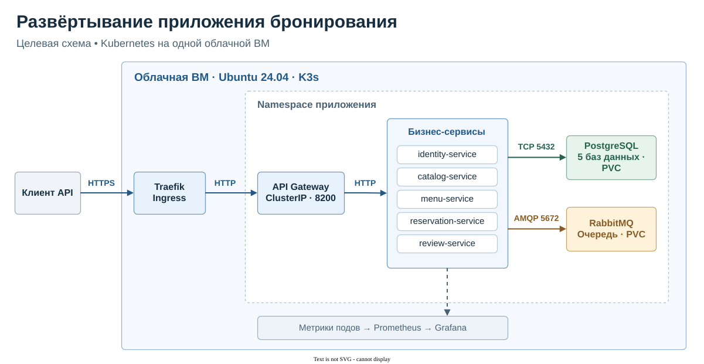
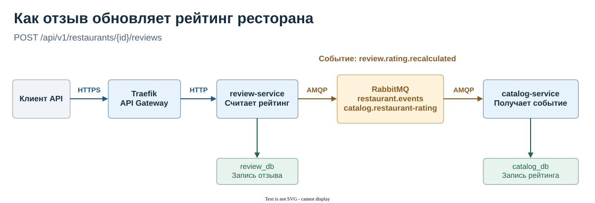

# ДЗ7. Технический дизайн облачной инфраструктуры

**Университет ИТМО · Бэк-энд разработка**  
**Проект:** сервис бронирования столиков в ресторанах  
**Выполнил:** Ермаков Максим, группа БР1.2  
**Проверил:** Добряков Д. И.  
Санкт-Петербург, 2026

## Задача

Спроектировать облачную инфраструктуру для приложения бронирования столиков. В проекте нужно выбрать облачные ресурсы, показать, как компоненты связаны по сети, и описать, что произойдёт при отказе приложения или сервера. По этому проекту в ЛР7 будет развёрнуто приложение. [Задание курса](https://github.com/kantegory/ITMO-ACS-Backend-2026-A/blob/main/README.md#дз7-технический-дизайн-облачной-инфраструктуры-для-микросервисного-веб-приложения)

## Ход работы

### 1. Что я переношу в облако

За основу я взял приложение из [ЛР4](../../labs/lab4/). Сейчас на `it-garage` Nginx принимает запросы и передаёт их в API Gateway. Приложение работает в Docker Compose: один Gateway, пять бизнес-сервисов, PostgreSQL и RabbitMQ. Для новой среды я сохраняю API, Dockerfile и разделение данных по сервисам. В облаке меняется способ запуска контейнеров, маршрутизация внешнего трафика и подключение хранилищ.

Я выбрал **K3s на отдельной облачной ВМ**. K3s — дистрибутив Kubernetes, подходящий для учебного кластера на одном узле. Он включает Traefik для маршрутизации запросов, CoreDNS для внутренних имён, локальное хранилище и Metrics Server. Отдельная ВМ позволяет проверять перенос и проводить нагрузочные испытания независимо от работающего экземпляра на `it-garage`. [Встроенные компоненты K3s](https://docs.k3s.io/installation/packaged-components)

### 2. Компоненты и облачные ресурсы

| Ресурс или компонент | Проектное решение |
| --- | --- |
| Облачная ВМ | Один узел Ubuntu 24.04 LTS. Плановый размер — 4 vCPU, 8 ГиБ RAM и SSD от 50 ГБ. Такой размер закладывает запас на приложение, мониторинг и дополнительные поды во время ЛР8. Фактическое потребление нужно проверить после запуска. |
| Публичный вход | Публичный IPv4, DNS-имя и TLS-сертификат. Внешние маршруты `/api/v1` и `/health` ведут через Traefik в `api-gateway`. Провайдер, IP и DNS-имя будут определены при развёртывании. |
| Gateway и бизнес-сервисы | Шесть `Deployment`, по одной реплике на старте. У каждого компонента свой `Service` типа `ClusterIP` со стабильным внутренним именем. |
| PostgreSQL 16 | Один `StatefulSet` с одной репликой и постоянным томом (`PVC`). Инициализация создаёт пять баз: `identity_db`, `catalog_db`, `menu_db`, `reservation_db`, `review_db`. Скрипт создания баз переиспользуется из ЛР4 при первом запуске на пустом томе. |
| RabbitMQ | Один `StatefulSet` с одной репликой, постоянным томом и стабильным именем узла. Сохраняются обменник `restaurant.events` и очередь `catalog.restaurant-rating`. |
| Резервные копии | Хранилище вне этой ВМ. Для учебного стенда достаточно зашифрованных выгрузок пяти баз, сохранённых отдельно от узла. |
| Наблюдаемость | Prometheus собирает метрики и результаты HTTP-проверок, Grafana показывает графики. Metrics Server предоставляет Kubernetes метрики CPU для HPA. Для логов можно перенести Loki и Alloy из ЛР6, заменив чтение Docker socket сбором логов подов через Kubernetes API. |

Размер ВМ я выбрал предварительно. Минимальные требования K3s относятся к Kubernetes и его встроенным компонентам. Для приложения, базы, очереди и мониторинга нужны ресурсы сверх этого минимума. [Требования K3s](https://docs.k3s.io/installation/requirements)

### 3. Сеть и доступ

*Рисунок 1. Проектная схема развёртывания. [Редактируемый исходник draw.io](diagrams/deployment.drawio).*

Клиент обращается к Traefik по HTTPS. Правило `Ingress` направляет запрос в `api-gateway` на порт `8200`. Gateway вызывает нужный микросервис по HTTP через внутренний DNS Kubernetes. Внутренние сервисы, базы и очередь доступны по адресам кластера. Для администрирования использую SSH с ключом и `kubectl` на узле. Kubernetes API и Grafana остаются закрытыми для публичного доступа. Для Grafana можно использовать SSH-туннель.

| Откуда → куда | Протокол и назначение |
| --- | --- |
| Клиент → Traefik | HTTPS `443`. HTTP `80` используется для перенаправления на HTTPS и может понадобиться при выпуске сертификата. |
| Traefik → `api-gateway` | HTTP `8200`. Сохраняются маршруты `/api/v1` и `/health`. |
| Gateway → `identity`, `catalog`, `menu`, `reservation`, `review` | Внутренний HTTP `8201–8205` соответственно. Микросервисы также используют существующие внутренние HTTP-вызовы, например `reservation-service` уточняет данные ресторана у `catalog-service`. |
| Бизнес-сервисы → PostgreSQL | TCP `5432`. Каждый сервис подключается к своей логической базе. |
| `review-service` и `catalog-service` → RabbitMQ | AMQP `5672`. Первый публикует событие, второй читает его из очереди. |

Обычные настройки, например имена сервисов и номера портов, храню в `ConfigMap`. Пароли PostgreSQL и RabbitMQ, ключи JWT и пароль администратора передаю через Kubernetes `Secret`. Значения создаются для новой среды и хранятся вне Git. Публично открываю только вход приложения. Доступ к SSH ограничиваю администрированием и, в ДЗ8, учётной записью развёртывания с правами в рабочем namespace.

### 4. Как проходит обновление рейтинга

*Рисунок 2. Путь от HTTP-запроса до обновления рейтинга в каталоге. [Редактируемый исходник draw.io](diagrams/rating-flow.drawio).*

После запроса на создание отзыва `review-service` сохраняет оценку в `review_db`, пересчитывает средний балл и количество отзывов и публикует событие `review.rating.recalculated`. RabbitMQ направляет событие в `catalog.restaurant-rating`. `catalog-service` читает событие, сохраняет `avgRating` и `reviewsCount` в `catalog_db` и подтверждает обработку брокеру. Обновление каталога может произойти чуть позже ответа на запрос создания отзыва.

Для проверки в ЛР7 я создам отдельный тестовый ресторан, оформлю бронь и оставлю один отзыв с оценкой 5. Доставку подтвержу записью `catalog-service applied review.rating.recalculated` для ID этого ресторана и значениями `avgRating=5` и `reviewsCount=1` в ответе каталога через Gateway. Проверка должна смотреть именно на эти поля: в карточке есть ещё `reviewsSummary`, который Gateway получает напрямую из `review-service`.

### 5. Сбои и восстановление

| Ситуация | Что произойдёт и как проверить |
| --- | --- |
| Процесс в поде завершился или завис | Kubernetes перезапустит завершившийся контейнер. Для зависания HTTP-сервиса используются проверки `/health`. Проверка запуска даёт приложению время инициализироваться, readiness допускает под к трафику, liveness обнаруживает длительный сбой ответа. Для демонстрации можно удалить под `menu-service` и посмотреть, как `Deployment` создаст замену. При одной реплике возможен краткий перерыв. |
| PostgreSQL или RabbitMQ перезапустились | При сохранном диске новый под подключит тот же PVC. После перезапуска PostgreSQL проверю, что ресторан остался в базе. После перезапуска RabbitMQ проверю обработку нового события. Если потребитель не подписался заново, перезапущу `catalog-service`: текущая версия подписывается на очередь при старте. |
| Вышла из строя ВМ или потерян диск | Все компоненты находятся на одном узле. При потере узла развёртываю кластер и манифесты на новой ВМ, создаю секреты, восстанавливаю PostgreSQL из внешних копий и обновляю DNS. Локальные тома привязаны к узлу. Необработанные сообщения могут быть потеряны вместе с диском RabbitMQ, поэтому после восстановления нужно проверить рейтинг по данным отзывов и при необходимости пересчитать его. |
| Неудачное обновление приложения | После выкладки проверяю готовность подов, `/health` и запрос к каталогу. Если новая версия не проходит проверки, возвращаю предыдущий тег образа и повторяю проверку. При изменении схемы БД совместимость нужно проверять отдельно. |

В текущем коде `/health` проверяет ответ HTTP-процесса. Чтобы заметить сбой в зависимостях, я также проверяю рабочий маршрут `GET /api/v1/restaurants` и сценарий с отзывом. План резервного копирования — ежедневная копия пяти баз и отдельная копия перед обновлением схемы. В ЛР7 проверю восстановление одной из копий на тестовых данных. [Проверки Kubernetes](https://kubernetes.io/docs/concepts/workloads/pods/probes/) · [Локальные тома K3s](https://docs.k3s.io/add-ons/storage)

### 6. Как этот проект используется дальше

| Работа | Что беру из ДЗ7 |
| --- | --- |
| **ЛР7 · Облачное развёртывание** | Подготовлю ВМ и K3s. Сначала разверну PostgreSQL и RabbitMQ с PVC и дождусь их готовности. Затем запущу шесть HTTP-компонентов и настрою Ingress. Проверю HTTPS с локального компьютера, регистрацию, бронирование, доставку события рейтинга, замену пода и сохранение данных. |
| **ДЗ8 · CI/CD** | Возьму схему GitHub Actions из ДЗ6 за основу. По push в выбранную ветку Actions запустит проверки, соберёт образы, опубликует их в GitHub Container Registry с тегом коммита, обновит `Deployment` и проверит результат выкладки. |
| **ДЗ9 · Документация** | Обновлю окружение Postman под облачный URL, опишу внешний API Gateway в OpenAPI со Swagger UI и опубликую документацию в MkDocs. Схему развёртывания можно переиспользовать в документации. |
| **ДЗ10 · Сценарии нагрузки** | Запланирую чтение списка и карточек ресторанов и отдельный сценарий с бронированиями на подготовленных данных. В k6 измерю RPS, p95, p99 и долю ошибок. Целевые значения задам при подготовке сценариев, чтобы потом сравнить с ними результаты. |
| **ЛР8 · Нагрузочные испытания и HPA** | Сначала измерю метрики на одной реплике Gateway, затем проверю HPA, например в диапазоне 1–3 реплик. Для расчёта загрузки CPU задам `requests.cpu` и проверю получение метрик от Metrics Server. В Grafana сравню загрузку подов и узла, задержки и ошибки до и после масштабирования. Начну с Gateway, поскольку он не хранит данные локально. Для сервисов с БД потребуется проверить параллельный запуск, в том числе автоматическую инициализацию схемы TypeORM. |

[Задания по облачному развёртыванию](https://github.com/kantegory/ITMO-ACS-Backend-2026-A/blob/main/README.md#4-облачное-развёртывание-веб-приложений) · [HPA в Kubernetes](https://kubernetes.io/docs/concepts/workloads/autoscaling/horizontal-pod-autoscale/)

## Вывод

Я спроектировал перенос приложения из Docker Compose в K3s на отдельной облачной ВМ. Такой стенд позволяет проверить работу Kubernetes, выпуск новой версии и масштабирование подов на существующем приложении. Один узел остаётся общей точкой отказа. При сбое пода помогает автоматический перезапуск, при потере узла — отдельная копия данных и план восстановления. В ЛР7 по этой схеме предстоит развернуть стенд и проверить его на сценарии бронирования и обновления рейтинга.
