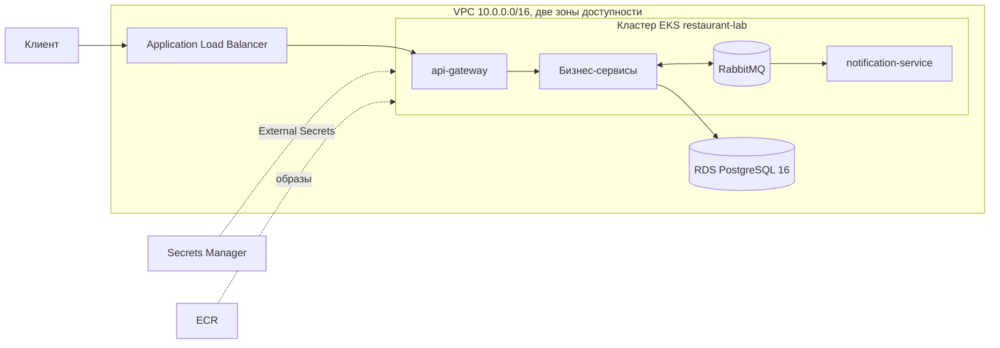

# Amazon EKS

Основной вариант облачного развёртывания. Инфраструктура описана в Terraform, приложение упаковано в Helm-чарт, а системные компоненты кластера получают права через EKS Pod Identity.

## Архитектура



## Ресурсы

| Ресурс | Параметры |
|--------|-----------|
| VPC | Публичные, приватные и изолированные подсети в двух зонах, один NAT Gateway |
| Amazon EKS | Два узла `m7i-flex.large`, расширение до трёх через Cluster Autoscaler |
| Amazon RDS | PostgreSQL 16 на `db.t4g.micro`, подключение только по TLS |
| Amazon ECR | Семь репозиториев образов со сканированием при загрузке |
| Secrets Manager | Пароли баз данных, ключ JWT и пароль RabbitMQ |

## Helm-чарт

Чарт `restaurant` создаёт для каждого сервиса Deployment, Service, HorizontalPodAutoscaler и PodDisruptionBudget, а также Ingress для балансировщика и StatefulSet для RabbitMQ. Пароли попадают в кластер из Secrets Manager через External Secrets Operator. Базы данных для сервисов создаёт Job, который запускается перед установкой как Helm hook.

## Развёртывание

```bash
cd labs/lab7/terraform
terraform init -backend-config="bucket=<бакет состояния>"
terraform apply
aws eks update-kubeconfig --name restaurant-lab --region ap-southeast-2
```

После создания кластера в него устанавливаются AWS Load Balancer Controller, External Secrets Operator, metrics-server и Cluster Autoscaler. Само приложение выкладывает пайплайн CD, описанный в разделе [CI/CD](../operations/cicd.md).

!!! warning "Стоимость"
    Кластер стоит около 0,4 доллара в час, поэтому после работы инфраструктура удаляется. Сначала удаляется Helm-релиз, чтобы контроллер удалил балансировщик, затем выполняется `terraform destroy`.
