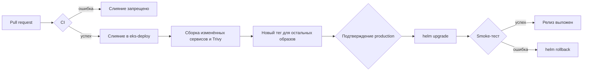

# CI/CD

Сборка, проверка и доставка приложения в Amazon EKS выполняются в GitHub Actions. Изменения попадают в ветку деплоя `eks-deploy` только через pull request.

## Непрерывная интеграция

Workflow `hw8-ci.yml` запускается для каждого pull request в `eks-deploy`.

- Определяет, какие сервисы, чарт или Terraform изменились.
- Собирает образы только изменённых сервисов. Сборка заодно компилирует TypeScript.
- Сканирует образы Trivy и не пропускает критические уязвимости, для которых есть исправление.
- Проверяет Helm-чарт командами `helm lint` и `helm template`, а Terraform командами `fmt`, `init` и `validate`.
- Выставляет итоговый статус `ci-result`, который обязателен для слияния по правилу ветки.

## Непрерывная доставка

Workflow `hw8-cd.yml` запускается после слияния.

- Пересобирает только изменённые сервисы, а остальным образам добавляет новый тег без пересборки.
- Перед деплоем ждёт ручного подтверждения в окружении GitHub `production`.
- Выполняет `helm upgrade` и smoke-тест через балансировщик.
- При ошибке деплоя или smoke-теста откатывает релиз командой `helm rollback`.

## Документация

Workflow `hw9-docs.yml` собирает этот сайт MkDocs, проверяет спецификацию OpenAPI и публикует сайт на GitHub Pages при изменении документации.
